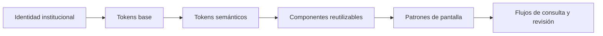

# Manual unificado de diseño visual e interfaces

## Plataforma de filiación SEIEM

| Dato | Descripción |
| --- | --- |
| Proyecto | `seiem-filiacion` |
| Institución | Servicios Educativos Integrados al Estado de México |
| Versión de este documento | 1.5.0 |
| Fecha de integración | 20 de octubre de 2026 |
| Idioma de interfaz | Español |
| Alcance | Identidad, tokens, componentes, pantallas, interacción, accesibilidad y mantenimiento del frontend |
| Referencia principal | Implementación actual del proyecto: hojas de estilo, componentes Blade, vistas y comportamiento JavaScript |
| Estado | Manual con normalización de acciones aplicada al código; verificación funcional y visual delimitada en 19.15 y 20.36. No constituye certificación integral de accesibilidad |

Este manual integra el **Manual de Estándares de Diseño Visual e Interfaces para Aplicaciones Institucionales** y **ESTANDAR_FRONTEND.md**. Su finalidad es explicar con precisión cómo se ve, cómo se organiza y cómo responde la plataforma actual, para que nuevas pantallas mantengan la misma identidad.

La apariencia implementada en este proyecto es la referencia de verdad. Las propuestas genéricas del PDF y las descripciones históricas del Markdown se ajustan cuando no coinciden con las vistas y estilos vigentes. Los documentos de origen se citan como antecedentes; su mención no significa que estén presentes en cada repositorio. La aplicación del estándar de acciones se registra en 19.13 y su verificación en 19.15.

**Regla normativa de acciones:** el capítulo 19 completa las decisiones que el código aún no unifica. Sus textos, iconos y comportamientos son el estándar que debe aplicarse a nuevas pantallas y correcciones. Las secciones anteriores describen también el estado observado; una etiqueta histórica no sustituye a la etiqueta canónica del capítulo 19. La identidad visual actual de Filiación se conserva como base. El capítulo 20 precisa su aplicación transversal: resuelve las variantes históricas de una misma acción y distingue reglas obligatorias, variantes por contexto y capacidades aún no implementadas.

## Índice

1. [Alcance, fuentes y precedencia](#1-alcance-fuentes-y-precedencia)
2. [Principios y lenguaje visual](#2-principios-y-lenguaje-visual)
3. [Identidad institucional y recursos](#3-identidad-institucional-y-recursos)
4. [Sistema de tokens](#4-sistema-de-tokens)
5. [Tipografía y contenido](#5-tipografía-y-contenido)
6. [Composición y plantilla institucional](#6-composición-y-plantilla-institucional)
7. [Catálogo de componentes](#7-catálogo-de-componentes)
8. [Patrones de pantalla](#8-patrones-de-pantalla)
9. [Interacción, reservas y persistencia](#9-interacción-reservas-y-persistencia)
10. [Adaptación a tamaños de pantalla](#10-adaptación-a-tamaños-de-pantalla)
11. [Accesibilidad y criterios de revisión](#11-accesibilidad-y-criterios-de-revisión)
12. [Implementación y ejemplos](#12-implementación-y-ejemplos)
13. [Usos correctos y prácticas que evitar](#13-usos-correctos-y-prácticas-que-evitar)
14. [Diferencias resueltas entre las fuentes](#14-diferencias-resueltas-entre-las-fuentes)
15. [Gobernanza y mantenimiento](#15-gobernanza-y-mantenimiento)
16. [Pendientes y límites conocidos](#16-pendientes-y-límites-conocidos)
17. [Glosario](#17-glosario)
18. [Trazabilidad y control de versiones](#18-trazabilidad-y-control-de-versiones)
19. [Estándar obligatorio de acciones, textos e iconos](#19-estándar-obligatorio-de-acciones-textos-e-iconos)
20. [Especificación transversal de componentes y estados](#20-especificación-transversal-de-componentes-y-estados)

## 1. Alcance, fuentes y precedencia

### 1.1 Qué documenta

El sistema atiende a personal que consulta y revisa expedientes de filiación. La interfaz favorece lectura de información administrativa, comparación de documentos, captura de fotografías y exportación. Por ello prima la legibilidad de nombres, CURP, RFC, fechas y datos de contacto sobre los recursos decorativos.

Se documentan las pantallas de acceso, solicitudes, expediente, usuarios, panel, importaciones y comprobación de la aplicación. La existencia de una vista o ruta no implica que tenga un enlace visible en el menú principal.

### 1.2 Orden para resolver diferencias

| Prioridad | Fuente | Aplicación |
| --- | --- | --- |
| 1 | Código actual de `seiem-filiacion` | Determina colores efectivos, medidas, composición, permisos y controles existentes |
| 2 | `ESTANDAR_FRONTEND.md` | Aporta decisiones, razones e historia; se contrasta con el código actual |
| 3 | Manual institucional en PDF | Aporta estructura metodológica, principios, documentación, gobernanza y pautas generales |
| 4 | Recomendaciones de este documento | Orientan mantenimiento y revisión; se identifican expresamente cuando aún no están implementadas |

El proyecto anterior `../frontend` aparece como antecedente en el Markdown original. Sus medidas se consideran incorporadas únicamente cuando también existen en el proyecto actual. No se requiere consultar ni modificar ese proyecto para aplicar este manual.

### 1.3 Cómo interpretar las especificaciones

- **Implementado:** comprobado en los archivos actuales. Describe el estado encontrado.
- **Regla de continuidad:** criterio que debe respetar una nueva implementación para conservar la identidad existente.
- **Recomendación o pendiente:** mejora que requiere implementación o validación posterior. No se presenta como una capacidad ya disponible.

La fidelidad documental no convierte una inconsistencia existente en una buena práctica. Cuando se encuentra una diferencia entre la regla deseada y el código, se registra en los pendientes.

## 2. Principios y lenguaje visual

### 2.1 Carácter de la interfaz

La plataforma utiliza un lenguaje institucional sobrio: vino en la estructura y en las acciones principales, dorado como acento puntual, superficies blancas y fondo gris casi blanco. Los bordes suaves y las sombras discretas separan contenidos sin producir una apariencia ornamental.

La jerarquía se construye con títulos, espacios, agrupaciones y contraste tipográfico. En un expediente largo, los números de sección y el índice aportan orientación; no es necesario repetir franjas doradas en cada bloque.

### 2.2 Principios operativos

| Principio | Aplicación concreta |
| --- | --- |
| Claridad | Cada acción expresa su resultado: “Guardar cambios”, “Descargar Excel”, “Liberar” |
| Consistencia | Un mismo control conserva familia tipográfica, radio, foco y estados en todas las vistas |
| Modularidad | Los tokens alimentan componentes; los componentes forman patrones de pantalla |
| Legibilidad | Los datos y textos funcionales usan Arial; las etiquetas no dependen del placeholder |
| Orientación | Migas, título de página, resumen del solicitante e índice del expediente mantienen el contexto |
| Respuesta visible | Cargas, errores, confirmaciones y conflictos de reserva tienen mensajes específicos |
| Protección del trabajo | Se distinguen datos guardados, borradores, fotografías persistidas y resultados de extracción |
| Acceso según función | La consulta administrativa y la revisión editable muestran acciones diferentes |



## 3. Identidad institucional y recursos

### 3.1 Logotipo de la barra superior

El archivo `public/images/logos/LOGOS.png` reúne el escudo y la identidad del Gobierno del Estado de México. Se coloca en el extremo superior izquierdo de las pantallas autenticadas, sobre el mismo vino de la barra.

| Propiedad | Especificación actual |
| --- | --- |
| Recurso | `images/logos/LOGOS.png`, servido con `asset()` |
| Dimensiones de origen documentadas | 1141 × 293 px |
| Altura habitual de presentación | 56 px; ancho automático |
| Ajuste vertical | Margen de −3 px arriba y abajo |
| Presentación a 580 px o menos | 44 px de alto, sin margen negativo |
| Texto alternativo | “Gobierno del Estado de México. Estado de México, ¡El poder de servir!” |
| Texto adyacente | No se agrega “SEIEM” ni una descripción junto al logotipo |

El margen negativo compensa el espacio interno del archivo. Deben conservarse sus proporciones: no estirar el escudo, separar artificialmente los elementos ni recolorear la imagen con filtros.

### 3.2 Identidad en la pantalla de acceso

El acceso presenta los logos sobre un panel vino. El colibrí `public/images/logos/COLIBRI.png` funciona como decoración de gran formato, parcialmente recortada, con opacidad de 0.3. No sustituye al logotipo ni constituye una acción.

La línea dorada, la pequeña barra de acento y el título del sistema refuerzan la marca. Estos elementos pertenecen al patrón de acceso; no deben repetirse de forma automática en listados o formularios.

### 3.3 Recursos tipográficos

| Recurso local | Familia y peso |
| --- | --- |
| `public/fonts/Gotham_Book.otf` | Gotham, 400 |
| `public/fonts/Gotham_Bold.otf` | Gotham, 700 |
| `public/fonts/montserrat-variable.ttf` | Montserrat, rango declarado 300–700 |

Las fuentes se declaran con `@font-face` y `font-display: swap`. La disponibilidad de archivos no sustituye la revisión de sus licencias cuando se redistribuyan fuera del proyecto.

## 4. Sistema de tokens

### 4.1 Organización

`public/css/institucional.css` contiene dos niveles de variables CSS. Los tokens base expresan valores concretos; los semánticos expresan funciones de interfaz. Para nuevos componentes se prefieren nombres semánticos: `--color-primary` describe mejor la intención que `--color-vino-800`.

El CSS existente incluye algunas referencias directas a tokens base y medidas particulares. La regla para ampliar el sistema es reutilizar los tokens disponibles y documentar cualquier nueva excepción.

### 4.2 Colores base

| Token base | Valor | Papel en el sistema |
| --- | --- | --- |
| `--color-vino-900` | `#3E1823` | Variante oscura |
| `--color-vino-800` | `#56212F` | Vino institucional |
| `--color-vino-600` | `#78454E` | Variante clara para interacción |
| `--color-vino-50` | `#F7EFF1` | Fondo vino muy tenue |
| `--color-dorado-500` | `#BC955B` | Dorado institucional |
| `--color-dorado-100` | `#F3EEE5` | Fondo dorado tenue |
| `--color-dorado-texto` | `#EADAC4` | Texto secundario sobre vino |
| `--color-dorado-700` | `#6B4E22` | Texto de advertencia |
| `--color-blanco` / `--color-negro` | `#FFFFFF` / `#000000` | Superficies y texto |
| `--color-gris-50` | `#F9F9F9` | Fondo general |
| `--color-gris-100` | `#F2F2F2` | Fondo neutro y solo lectura |
| `--color-gris-300` | `#D9D9D9` | Separadores y contornos suaves |
| `--color-gris-500` | `#767676` | Borde de controles y placeholder |
| `--color-gris-700` | `#4A4A4A` | Texto secundario |
| `--color-gris-800` | `#333333` | Texto sobre dorado |
| `--color-rojo-600` / `--color-rojo-700` | `#D93025` / `#B3261E` | Error y error intenso |
| `--color-rojo-50` | `#FCEFEE` | Fondo de error |
| `--color-verde-700` / `--color-verde-50` | `#1E6B43` / `#EAF4EE` | Éxito y fondo de éxito |
| `--color-azul-800` / `--color-azul-50` | `#1F4E79` / `#EBF2F8` | Información y fondo informativo |

### 4.3 Colores semánticos

| Token semántico | Valor efectivo | Aplicación |
| --- | --- | --- |
| `--color-primary` | `#56212F` | Barra, menú, botones principales y enlaces |
| `--color-primary-light` | `#78454E` | Hover habitual y foco general |
| `--color-primary-dark` | `#3E1823` | Hover del botón de acceso |
| `--color-primary-lightest` | `#F7EFF1` | Interacción secundaria y sección activa |
| `--color-secondary` | `#BC955B` | Líneas de marca y acentos |
| `--color-secondary-lightest` | `#F3EEE5` | Advertencias suaves |
| `--color-on-primary` | Blanco | Texto sobre vino |
| `--color-on-primary-muted` | `#EADAC4` | Texto de apoyo sobre vino |
| `--color-on-primary-active` | Blanco al 12 % | Fondo activo del menú |
| `--color-on-primary-divider` | Blanco al 20 % | Divisor del menú |
| `--color-on-secondary` | `#333333` | Texto sobre fondo dorado |
| `--color-background` / `--color-surface` | `#F9F9F9` / blanco | Página y contenidos |
| `--color-neutral` | `#F2F2F2` | Estado neutro |
| `--color-text-primary` / `--color-text-secondary` | Negro / `#4A4A4A` | Texto principal y de apoyo |
| `--color-border` | `#D9D9D9` | Tarjetas, tablas y divisores |
| `--color-border-input` | `#767676` | Contorno de controles |
| `--color-error` / `--color-error-strong` | `#D93025` / `#B3261E` | Borde de error, acción destructiva y texto intenso |
| `--color-error-background` | `#FCEFEE` | Alerta de error |
| `--color-warning-text` | `#6B4E22` | Texto sobre advertencia clara |
| `--color-success` / `--color-success-background` | `#1E6B43` / `#EAF4EE` | Éxito |
| `--color-info` / `--color-info-background` | `#1F4E79` / `#EBF2F8` | Información |
| `--color-white` | Blanco | Alias de texto blanco |

El dorado se reserva para acentos y decoración. En las etiquetas con fondo dorado se utiliza texto oscuro. El texto funcional sobre blanco utiliza vino, negro o un color semántico oscuro, según su función.

### 4.4 Espaciado

| Token | Valor | Uso habitual |
| --- | --- | --- |
| `--spacing-4` | 4 px | Separaciones pequeñas y acentos |
| `--spacing-8` | 8 px | Ícono con texto, etiqueta y control |
| `--spacing-16` | 16 px | Celdas, controles y grupos compactos |
| `--spacing-24` | 24 px | Interior de tarjetas y separación de campos |
| `--spacing-32` | 32 px | Contenido principal y separación estructural |
| `--spacing-48` | 48 px | Espacios amplios y estados vacíos |
| `--spacing-64` | 64 px | Reserva para composición amplia |

El ritmo general utiliza múltiplos de 4 y 8 px. El código conserva medidas específicas de marca y de componentes —12, 18, 20, 28 o 40 px, entre otras— que se describen en sus fichas. Estas excepciones no crean automáticamente nuevos tokens globales.

### 4.5 Bordes, sombras y movimiento

| Token | Valor actual |
| --- | --- |
| `--border-radius` | 8 px |
| `--border-radius-pill` | 999 px |
| `--shadow-sm` | `0 1px 2px rgba(0, 0, 0, .06)` |
| `--shadow-md` | `0 8px 24px rgba(0, 0, 0, .12)` |
| `--shadow-lg` | `0 16px 48px rgba(0, 0, 0, .24)` |
| `--transition-base` | `150ms ease-in-out` |
| `--backdrop` | `rgba(27, 26, 28, .45)` |
| `--focus-ring` | `3px solid var(--color-primary-light)` |
| `--focus-ring-on-primary` | `3px solid var(--color-secondary)` |
| `--header-height` | 80 px; 72 px a ≤820; 68 px a ≤580 |

El foco general se dibuja con separación exterior de 2 px. Los campos tienen su propio halo. La preferencia `prefers-reduced-motion: reduce` reduce animaciones y transiciones a 1 ms.

### 4.6 Tokens de tarjetas y campos

| Token | Valor o referencia |
| --- | --- |
| `--card-background` | `--color-surface` |
| `--card-radius` | 8 px |
| `--card-border` | `1px solid var(--color-border)` |
| `--card-accent` | `6px solid var(--color-secondary)` |
| `--card-padding` | `--spacing-24` |
| `--shadow-card` | `0 2px 8px rgba(86, 33, 47, .08)` |
| `--shadow-card-hover` | `0 8px 24px rgba(86, 33, 47, .14)` |
| `--shadow-card-elevated` | `0 14px 34px rgba(86, 33, 47, .12)` |
| `--input-radius` | 8 px |
| `--input-border-color` | `--color-border-input` |
| `--input-hover-border` | `--color-gris-700` |
| `--input-focus-border` | `--color-primary` |
| `--input-focus-halo` | `0 0 0 3px rgba(188, 149, 91, .35)` |

## 5. Tipografía y contenido

### 5.1 Familias y responsabilidades

La interfaz utiliza dos familias funcionales. Gotham aporta identidad en títulos y texto corrido; Arial facilita la lectura de información capturada y textos de operación. Montserrat es la alternativa local de la familia base.

```css
--font-family-base: 'Gotham', 'Montserrat', Arial, sans-serif;
--font-family-ui: Arial, Helvetica, sans-serif;
```

`--font-family-ui` se aplica a etiquetas, leyendas, botones, campos, tablas, términos de definición, `strong`, `b`, estados, menús, índice y otros textos funcionales. Un título que contenga un `strong` puede recibir esta familia en ese fragmento por la regla global.

La decisión se originó en la legibilidad de caracteres de Gotham Bold, especialmente en palabras de operación y datos como CURP o RFC. Gotham y Montserrat son familias sans serif; no se hereda del PDF su clasificación imprecisa de Gotham Bold como serif.

### 5.2 Escala

| Token o elemento | Tamaño | Peso e interlínea |
| --- | --- | --- |
| `--font-size-sm` | 14 px | Apoyo, etiquetas, tablas y botones |
| `--font-size-base` | 16 px | Cuerpo y datos de entrada |
| `--font-size-md` | 20 px | H3 y títulos de bloques compactos |
| `--font-size-lg` | 24 px | H2 y H1 en móvil |
| `--font-size-xl` | 32 px | H1 de escritorio |
| Cuerpo | 16 px | Peso 400, interlínea 1.5 |
| Encabezados | Según jerarquía | Peso 700, interlínea 1.25 |

El token de peso ligero 300 existe, pero Gotham solo declara 400 y 700. No se debe asumir que hay un archivo Gotham Light disponible.

### 5.3 Excepciones vigentes

- El título de marca del acceso usa `clamp(36px, 3vw, 48px)`, interlínea 1.06 y ajuste de letras de −0.5 px. En los cortes móviles cambia a una escala de 29–38 px y finalmente a 29 px.
- El título “Inicia sesión” mide 32 px y pasa a 30 px en el corte de 520 px.
- Ayudas de cámara, compatibilidad, placeholder de fotografía y ayuda de encuadre incluyen textos de 12 px.
- Algunos símbolos y números tienen medidas propias: el símbolo del diálogo de estado usa 26 px.

Por tanto, “ningún texto baja de 14 px” debe leerse como regla general deseada del documento anterior, no como una descripción exacta de toda la implementación. Las excepciones de 12 px requieren revisión de legibilidad al ampliar el sistema.

### 5.4 Redacción de la interfaz

Para nombres de acciones, títulos de formularios, mensajes de confirmación y carga, aplicar el catálogo normativo del capítulo 19. No elegir sinónimos por pantalla.

Usar verbos concretos y español consistente. Un mensaje de error debe explicar qué ocurrió y, cuando sea posible, cómo continuar. Reservar MAYÚSCULAS para encabezados de tabla, pequeñas etiquetas de contexto y datos normalizados; no utilizarlas en párrafos completos.

Los campos de revisión marcados con `data-mayusculas` convierten texto al escribir. Correo, teléfono y fecha conservan el tratamiento adecuado a su tipo. Las fechas de solicitudes se presentan en formato `d/m/Y`, con hora cuando corresponde, usando `America/Mexico_City`; la pantalla de comprobación identifica expresamente su hora como UTC.

## 6. Composición y plantilla institucional

### 6.1 Estructura autenticada

La plantilla `resources/views/components/layouts/institucional.blade.php` compone encabezado, navegación opcional, contenido, pie, notificaciones y confirmación compartida.

```text
┌─────────────────────────────────────────────────────────────┐
│ Logo institucional             Contexto / usuario / acciones │
├───────────────┬─────────────────────────────────────────────┤
│ Navegación   │ Migas, título y descripción                  │
│ cuando       │                                             │
│ corresponde  │ Tarjetas, tabla o expediente                 │
│               │                                             │
│ Cerrar sesión│ Pie institucional                            │
└───────────────┴─────────────────────────────────────────────┘
```

El revisor no tiene navegación lateral; su contenido ocupa el ancho disponible y el cierre de sesión se coloca en la barra superior. El administrador conserva el menú con “Solicitudes” y “Usuarios y permisos”. Importaciones, salud y panel tienen rutas propias, pero no aparecen como entradas de este menú actual.

**Regla general del menú lateral.** El menú lateral solo se muestra cuando el rol tiene **dos o más secciones** a las que navegar. Con una sola sección, un menú de una opción ocupa espacio y no orienta. En ese caso se aplica la variante sin menú: `body.sin-menu`, contenido a todo el ancho, sin botón de menú móvil y con el cierre de sesión como control compacto `.header-logout` en la barra superior (icono `salir`, `aria-label` y `title` “Cerrar sesión”). El logotipo sigue llevando al inicio.

| Sistema | Rol | Menú lateral | Secciones |
| --- | --- | --- | --- |
| Expedientes | Administrador | Sí | Expedientes, Usuarios y permisos, Auditoría |
| Expedientes | Cargador | Sí | Expedientes, Crear expediente |
| Expedientes | Lector | No | Solo Expedientes |

### 6.2 Barra superior

| Propiedad | Escritorio | ≤1150 px | ≤820 px | ≤580 px |
| --- | --- | --- | --- | --- |
| `min-height` interior | 78 px | 78 px | 70 px | 66 px |
| Padding interior | 14 px 40 px | 14 px 28 px | 13 px 24 px | 11 px 18 px |
| Borde inferior | 2 px dorado | Igual | Igual | Igual |
| Logo | 56 px | 56 px | 48 px | 44 px |
| Token de desplazamiento | 80 px | 80 px | 72 px | 68 px |

La barra es `sticky`, con `top: 0` y `z-index: 30`. A la derecha aparecen el contexto de la plataforma y la identidad del usuario. A ≤820 px se oculta el nombre de plataforma; a ≤580 px también se oculta el rol. El nombre de usuario se trunca visualmente con puntos suspensivos en el corte pequeño, conservando el texto completo y un `title` con su nombre. El logotipo y el botón de menú no se encogen ni se superponen con la identidad del usuario.

Los valores de la tabla son las declaraciones CSS. `min-height` y `--header-height` no garantizan por sí solos la altura final: padding, logo, márgenes y ajuste de contenido pueden aumentar la caja. Debe comprobarse en navegador que los elementos sticky y las anclas no queden cubiertos, especialmente en el corte de 820 px.

### 6.3 Navegación lateral

- Columna de 256 px; a ≤1100 px pasa a 224 px.
- Fondo vino y texto blanco; etiquetas de grupo en `--color-on-primary-muted`.
- Enlaces de altura mínima 48 px, radio 8 px y separación de 16 px entre ícono y texto.
- Elemento activo con `aria-current="page"`, borde izquierdo dorado de 4 px y blanco al 12 % como fondo.
- Navegación sticky debajo del encabezado; cierre de sesión al final.

El botón de menú y la ocultación de la barra lateral se activan a ≤820 px cuando existe mejora JavaScript. Al abrir, el control cambia de Menú a Cerrar y actualiza su nombre accesible.

### 6.4 Área principal y pie

El contenido tiene ancho máximo de 1440 px, centrado, con padding de 32 px. La estructura utiliza `minmax(0, 1fr)` y `min-width: 0` para permitir que tablas y formularios se adapten sin ensanchar todo el documento.

El pie presenta “SEIEM / Plataforma de filiación” en vino con diagonal dorada, y el nombre completo de la institución. Tiene fondo blanco, borde superior gris y padding de 24 px 40 px 28 px. A ≤1150 px cambia el padding horizontal a 28 px; a ≤820 px se apila y usa 16 px 24 px.

## 7. Catálogo de componentes

### 7.1 Botones y enlaces de acción

El capítulo 19 determina qué texto e icono corresponde a cada acción. Esta sección describe dimensiones y variantes; tener variante primaria no exige por sí solo llevar icono.

El componente `<x-ui.boton>` ofrece variantes `primary`, `secondary` y `danger`. La jerarquía depende de la importancia de la acción, no del módulo donde se utilice.

| Variante | Apariencia normal | Hover | Uso |
| --- | --- | --- | --- |
| Primario | Fondo y borde vino, texto blanco | Vino claro | Acción principal del grupo o formulario |
| Secundario | Fondo blanco, borde y texto vino | Fondo vino tenue | Cancelar, volver, actualizar, descargar |
| Peligro | Fondo y borde rojo, texto blanco | Rojo intenso | Aceptación de una operación destructiva |

Especificación común: altura mínima 44 px, padding 8 px 16 px, texto Arial de 14 px y peso 700, radio 8 px, separación de 8 px entre ícono y texto y transición de 150 ms. El botón de acceso tiene altura mínima 48 px, texto de 16 px y hover vino oscuro.

El estado deshabilitado usa opacidad 0.5 y cursor `not-allowed`. En controles nativos se utiliza `disabled`; `aria-disabled="true"` comunica el estado de elementos no nativos, pero debe acompañarse de lógica que impida la acción.

| Variante compacta | Medida actual |
| --- | --- |
| `.table-action` | Acción de fila sin borde ni fondo; mínimo 44 px de alto, padding 8 px e icono de 18 px. Sustituye a `.review-button` |
| `.icon-button` | 44 × 44 px |
| Flechas de paginación | 44 × 44 px |
| Botones de fotografía | Mínimo 44 px, con separación de 8 px e iconos de 18 px |
| Cierre de toast | 32 × 32 px |
| Acciones de recuperación de reserva | Mínimo 44 px |

Las acciones de tabla y los controles nuevos deben medir al menos 44 px de alto. Las referencias históricas a botones de revisión de 36 px quedan sustituidas por `.table-action`; no constituyen una excepción vigente.

### 7.2 Campos de formulario

`.form-field` organiza etiqueta, control, ayuda y error en columna. Usa gap de 8 px y margen inferior de 24 px. El campo `.input-text` ocupa todo el ancho y mide al menos 44 px, con texto de 16 px, padding de 8 px 16 px, fondo blanco, borde de 1 px y radio de 8 px.

| Estado | Tratamiento |
| --- | --- |
| Reposo | Borde `--input-border-color`, actualmente `#767676` |
| Hover | Borde `--input-hover-border`, actualmente `#4A4A4A` |
| Foco | Borde vino y halo dorado de 3 px; sin outline genérico |
| Error | Borde rojo y sombra roja de 1 px; texto de error con ícono |
| Solo lectura | Fondo neutro y texto secundario |
| Deshabilitado | Fondo neutro, texto secundario y cursor no permitido |

La etiqueta debe asociarse con el control mediante `for` e `id`. Los obligatorios indican su condición mediante texto o asterisco explicado, además del marcado correspondiente. Los errores deben relacionarse con el campo mediante `aria-describedby` y `aria-invalid` cuando aplique.

El buscador de solicitudes es una excepción a la etiqueta visible: tiene etiqueta `.sr-only` y contexto de búsqueda. No debe usarse esta excepción para omitir etiquetas en formularios de captura.

Controles especiales:

- `textarea.input-text`: altura mínima 112 px y ajuste vertical.
- `select.input-text`: flecha SVG vino de 18 px, situada a 16 px del borde derecho; padding derecho de 48 px.
- `input[type=file].input-text`: selector nativo con botón integrado de estilo institucional.
- Checkbox: control de 20 × 20 px dentro de etiqueta con altura mínima 44 px y acento vino.
- Fecha: control nativo; su selector y formato de edición pueden variar según navegador.

### 7.3 Contraseña

`.password-field` integra el campo y el botón “Mostrar/Ocultar” dentro de un solo borde. El divisor interior es gris suave; el radio exterior se mantiene en 8 px. El foco en cualquiera de sus partes activa el borde vino y el halo mediante `:focus-within`.

El botón de visibilidad incluye un indicador interior de foco de teclado. En el acceso tiene ancho mínimo 80 px. Su acción cambia la visibilidad sin enviar el formulario y debe conservar la asociación con el campo.

### 7.4 Tarjetas

La tarjeta base tiene fondo blanco, borde gris de 1 px, radio de 8 px, sombra vino discreta y padding de 24 px. `.card-plain` retira el borde cuando la separación por sombra es suficiente.

| Componente | Tratamiento específico |
| --- | --- |
| `.card` | Base sin acento superior |
| `.access-card` | Borde superior dorado de 6 px, máximo 512 px, padding 40 px y sombra elevada |
| `.stat-card` | Variante disponible en CSS con acento dorado y hover vino; no se utiliza en el panel actual |
| `.form-section` | Bloque del expediente sin franja dorada; el número identifica la sección |
| `.selected-summary` | Borde izquierdo vino de 4 px |
| `.actions-row` | Barra de acciones con tratamiento de superficie; no es una sección del expediente |
| `.narrow-card` | Ancho máximo 720 px |

El acento dorado superior se reserva para acceso y la variante de indicadores. No se aplica a todas las tarjetas del sistema. Una tarjeta de contenido no debe elevarse con hover como si fuera un enlace cuando no tiene interacción.

### 7.5 Tablas

Las tablas utilizan `.data-table` dentro de `.table-scroll`. El contenedor tiene fondo blanco, borde gris y radio de 8 px. En un listado normal no tiene altura máxima ni desplazamiento vertical interno: la página crece con sus 10 filas. Conserva el desplazamiento horizontal cuando los datos no caben. Solo una zona de altura limitada justificada, como un diálogo, puede usar `.table-scroll-limited` (máximo 70vh); véase el capítulo 20. Su `position: relative` también mantiene los textos ocultos de accesibilidad dentro del contexto de recorte esperado.

| Elemento | Especificación |
| --- | --- |
| Tabla base | Ancho 100 %, mínimo 640 px; bordes separados sin separación |
| Tabla de solicitudes | Mínimo 1040 px |
| Encabezados | Sticky, fondo `#F9F9F9`, 14 px, negritas, mayúsculas, espaciado de letras `.04em` |
| Padding de encabezado | 12 px verticales y 16 px horizontales |
| Celdas | 16 px, texto de 14 px, color secundario y separador inferior |
| Dato principal | `strong` en negro, visible en bloque |
| Dato de apoyo | `small` de 14 px debajo, con margen de 4 px |
| Hover | Fondo gris casi blanco en la fila |
| Acciones | Última columna, alineada a la derecha, sin corte de texto |

No hay rayado alternado ni ordenamiento interactivo de columnas en el listado actual. La presencia de encabezados no debe sugerir que se puede ordenar al pulsarlos.

El contenedor de solicitudes es una región identificada, con `tabindex="0"`; los encabezados utilizan `scope="col"`. El desplazamiento horizontal se conserva para proteger la lectura de los datos.

### 7.6 Paginación y estados vacíos

La paginación comparte el patrón `.table-pagination`: rango de resultados a la izquierda y controles de navegación a la derecha, con espacio de 16 px. Las flechas inexistentes se muestran deshabilitadas; se presenta “Página X de Y”.

**Pie obligatorio en toda tabla.** Toda tabla de datos muestra el conteo **debajo de la tabla**, nunca arriba ni junto a los filtros, con el formato único “X–Y de Z” o “0 registros”:

| Caso | Implementación |
| --- | --- |
| Tabla paginada | `{{ $paginador->links('pagination.institucional') }}`: rango y, si hay más de una página, controles |
| Tabla sin paginación (detalle, diálogos, tablas parciales) | `<x-ui.pie-tabla :total="…"/>`: el mismo rango, sin controles |
| Tabla filtrada en el navegador | El mismo pie, con `role="status"`; el script actualiza el rango con las filas visibles (“1–1 de 1”, “0 registros”) |

El conteo descriptivo del encabezado de un listado (“12 expedientes”, bajo el título de la tarjeta) se conserva solo en las tarjetas de listado principal. No sustituye al pie.

**Tamaño estándar obligatorio: 10 registros por página.** Es el valor inicial y básico de todos los listados paginados, incluidas solicitudes, usuarios y tablas de selección. Al limpiar filtros se conserva este tamaño. No se añade un selector «Por página» a las barras de filtros por defecto. Solo en casos extraordinarios puede emplearse otro tamaño: la excepción debe documentarse en la sección de la pantalla, indicando el número de filas, la necesidad funcional y su efecto en rendimiento y lectura. La cantidad total de registros, por sí sola, no justifica una excepción; se recorre mediante las páginas. Un parámetro de URL no debe cambiar el tamaño si la pantalla no tiene una excepción aprobada.

Los estados vacíos muestran ícono neutro, título y explicación. En solicitudes: “Aún no hay solicitudes” cuando no hay registros, o “Sin coincidencias” cuando la búsqueda no encuentra resultados. El segundo caso invita a ajustar el texto de búsqueda.

### 7.7 Etiquetas y estados

`.badge` tiene forma de pastilla, fondo dorado y texto gris oscuro. `.status-badge` añade borde del color del texto y un punto de 8 px. La descripción escrita es obligatoria para que el significado no dependa del color.

| Clase disponible | Fondo | Texto | Uso o condición |
| --- | --- | --- | --- |
| `.status-activo` / `.status-revisada` | `#EAF4EE` | `#1E6B43` | Activo y variante histórica revisada |
| `.status-inactivo` | `#F2F2F2` | `#4A4A4A` | Desactivado o neutro |
| `.status-en_revision` | `#F3EEE5` | `#6B4E22` | Variante histórica |
| `.status-rechazada` | `#FCEFEE` | `#B3261E` | Variante histórica |

Las variantes históricas siguen en CSS, pero **la tabla actual no tiene columna “Estado”**. “En revisión por” y los botones con candado expresan disponibilidad de reserva; no deben confundirse con un catálogo de estados de trámite.

Las fotografías tienen `.photo-status`, una pastilla sin borde: pendiente en neutro, activa en dorado tenue y capturada en verde tenue.

### 7.8 Avisos y notificaciones

| Recurso | Cuándo utilizarlo | Apariencia |
| --- | --- | --- |
| `.notice` | Contexto, reserva activa o disponibilidad de un servicio | Superficie blanca, borde suave, línea izquierda dorada e ícono vino |
| `.alert-success` | Resultado satisfactorio persistente | Fondo y borde verdes |
| `.alert-error` | Validación o error que debe seguir visible | Fondo rojo suave, borde rojo y texto rojo intenso |
| `.alert-info` | Información relevante en página | Fondo y borde azules |
| Toast | Confirmación breve sin cambiar la tarea | Superficie blanca, sombra y borde izquierdo semántico |

Las alertas y avisos tienen padding de 16 px, radio de 8 px y borde izquierdo de 4 px. Los errores de validación generales se resumen al inicio del contenido.

Los estilos de toast definen una región fija arriba a la derecha, a 16 px de los bordes, con ancho máximo 400 px y `z-index: 60`. El soporte JavaScript permite cierre y autocierre mediante `data-autocierre`; la entrada y salida utilizan transiciones breves de 200 ms. El estándar anterior proponía 6 segundos, pero el tiempo no está fijado globalmente en el código actual. Los mensajes actuales de sesión de éxito, advertencia y error se entregan como avisos iniciales a la ventana de estado; no se debe afirmar que todo éxito aparece como toast.

### 7.9 Confirmación compartida

`<x-ui.modal-confirmacion>` utiliza `<dialog>` y una tarjeta de máximo 480 px, limitada por el ancho de la ventana menos 32 px. Tiene radio de 8 px, sombra grande y padding de 24 px. El fondo usa `--backdrop`.

El encabezado combina símbolo circular de 48 px, título de 20 px, descripción y cierre. Las acciones se alinean a la derecha, separadas del contenido por un borde superior. La variante destructiva cambia el símbolo y el botón de aceptación al tratamiento de peligro.

Se activa desde atributos declarativos:

| Atributo | Función |
| --- | --- |
| `data-confirm` | Mensaje que se debe aceptar |
| `data-confirm-title` | Título del diálogo |
| `data-confirm-accept` | Texto específico de aceptación |
| `data-confirm-variant="danger"` | Tratamiento destructivo |

El diálogo ofrece cancelar, cerrar y aceptar. Debe mantener el foco dentro mientras está abierto y devolverlo a un destino útil al cerrarse. El manejo de eventos contempla controles que Livewire vuelve a dibujar.

### 7.9.1 Diálogo de formulario

`<x-ui.dialogo id titulo descripcion amplio peligro>` reutiliza la tarjeta de la confirmación (`.modal`) para formularios breves que no justifican una pantalla propia. Su ancho es de 560 px (`.modal-form`) o de 920 px (`amplio`, para tablas), con un máximo de la ventana menos 32 px y desplazamiento interno. La variante `peligro` agrega un borde superior rojo de 4 px.

| Regla | Aplicación |
| --- | --- |
| Apertura | Un botón con `data-dialogo-abrir="id"`; el foco pasa al primer campo |
| Cierre | “Cancelar” (secundario, sin icono) y la X (`data-dialogo-cerrar`) o Escape. Un clic en el fondo no lo cierra, para no perder datos escritos. El foco vuelve al control de origen o, si se abrió desde un menú, al botón de acciones de la fila |
| Acciones | `.modal-actions`: Cancelar a la izquierda; la acción con su verbo, icono y variante (primaria o de peligro) a la derecha |
| Validación | Cada formulario envía `_dialogo` con su id. Si vuelve con errores, ese diálogo se reabre al cargar, los valores anteriores solo se restauran en él y `<x-ui.error-campo dialogo="…">` muestra los errores únicamente en ese diálogo |
| Confirmación | Un diálogo que ya describe la consecuencia (dar de baja) no agrega un segundo `data-confirm`. Una acción secundaria dentro del diálogo (restaurar una versión) sí conserva su confirmación |

### 7.9.2 Cuándo usar página de formulario, diálogo o confirmación

La elección depende de la tarea, no del módulo. Se aplica la primera fila que corresponda:

| Situación | Patrón | Motivo | Ejemplos |
| --- | --- | --- | --- |
| Se crea una entidad nueva que después tendrá su propia pantalla | **Página de formulario** | Tiene URL propia, admite volver con el navegador y, al terminar, lleva al detalle creado | Crear expediente, Crear usuario |
| El formulario tiene más de seis campos, varias secciones, ayuda extensa o requiere consultar otra información mientras se llena | **Página de formulario** | Un diálogo largo con desplazamiento oculta el contexto y dificulta revisar errores | Editar usuario (datos, rol, acceso y contraseña) |
| Una operación breve sobre un objeto que ya se está viendo (seis campos o menos, una sola decisión) y después se vuelve a la misma vista | **Diálogo de formulario** (7.9.1) | Conserva el contexto; no hay que navegar ni reconstruir la vista | Editar datos, Cargar documentos, Cargar nueva versión, Editar clasificación, Dar de baja con motivo |
| Consultar información secundaria de un objeto, sin edición | **Diálogo amplio** de solo lectura | Evita una página que solo contiene una tabla | Historial de versiones |
| Una operación sin datos que capturar, que solo requiere aceptar su consecuencia | **Confirmación** (7.9) | Solo pregunta sí o no | Restaurar versión, Revocar permiso |
| Una operación sin consecuencia relevante | **Acción directa**, sin diálogo | Una confirmación innecesaria entorpece | Consultar, Descargar, Actualizar |

Reglas complementarias:

- No se anida un diálogo de formulario dentro de otro. Desde un diálogo solo puede abrirse una confirmación.
- Si un diálogo crece por encima de seis campos o necesita pestañas, se convierte en página.
- El mismo tipo de operación usa el mismo patrón en todo el sistema. Si “Editar datos” es un diálogo en un detalle, no se convierte en página en otro.
- La página de formulario usa `.card.narrow-card`, con “Cancelar” (secundario) que vuelve al origen y la acción primaria con su verbo.

### 7.10 Ventana de estado y procesamiento

La ventana creada por `revision.js` es distinta de la confirmación: informa de un resultado o de una operación en curso. Su ancho máximo es 460 px, con 40 px de margen total respecto a la ventana, padding de 32 px y separación interna de 18 px.

| Variante | Señal visual | Comportamiento |
| --- | --- | --- |
| Información | Borde superior dorado de 3 px y símbolo vino | Botón “Aceptar” |
| Éxito | Borde y símbolo verdes | Botón “Aceptar” |
| Error | Borde y símbolo rojos intensos | Explica el problema |
| Procesamiento | Indicador circular giratorio | Sin botón de aceptación ni cierre con Escape durante el proceso |

El símbolo mide 44 px y el título 24 px. El fondo superpuesto incluye desenfoque de 3 px. El contenido tiene altura limitada y desplazamiento interno para mensajes largos. Los avisos se encolan para evitar superponer ventanas.

Los formularios con `data-cargando="mensaje"` muestran el estado correspondiente. El texto debe nombrar la operación: “Abriendo solicitud…”, “Analizando documento...” o “Guardando fotografía…”.

### 7.11 Migas de navegación

`<x-ui.migas>` representa una lista horizontal que puede envolver, con separador `>` y texto de 14 px. Los enlaces anteriores se destacan en peso 700; el último elemento identifica la ubicación actual.

Las migas complementan el botón de volver. No deben generar una salida de la revisión que omita las comprobaciones de reserva y cambios sin guardar.

### 7.12 Iconografía

La presencia obligatoria o ausencia de icono por acción se define en el capítulo 19. La tabla siguiente registra los alias existentes. `agregar` está incorporado al catálogo compartido.

`<x-ui.icono>` centraliza SVG con `viewBox="0 0 24 24"`, sin relleno, trazo de 1.75 px y extremos redondeados. El color se hereda con `currentColor`. El tamaño base es 24 px y la variante `.icono-sm` mide 18 px.

| Alias de `nombre` | Uso habitual |
| --- | --- |
| `agregar` | Crear una entidad |
| `documento`, `inicio` | Expedientes e inicio |
| `usuarios` | Usuarios y permisos |
| `buscar` | Buscar, revisar o analizar |
| `salir` | Cerrar sesión |
| `check` | Confirmar o guardar |
| `candado`, `desbloquear` | Reserva y liberación |
| `flecha` | Continuar o navegar; puede invertirse |
| `actividad` | Comprobación de actividad |
| `importar`, `descargar`, `subir` | Transferencia de información |
| `cerrar`, `menu` | Cierre y navegación adaptable |
| `alerta`, `info` | Error e información |
| `editar`, `eliminar` | Modificación y eliminación |
| `calendario`, `camara`, `actualizar`, `devolver` | Fecha, fotografía, actualización y retorno |
| `opciones` | Botón único de acciones de una fila (solo icono) |
| `historial` | Historial de versiones |

Cada SVG incluye `aria-hidden="true"` y `focusable="false"`, además de `icon-{nombre}`. El control que lo contiene aporta su nombre accesible. Los alias ilustrativos `icon-user` o `icon-print` del PDF no son parte del catálogo implementado.

### 7.13 Menú de acciones de fila

Cuando una fila admite más de una operación, **todas** sus acciones, incluida “Consultar”, se reúnen en un único botón de solo icono (`.row-menu-button`, icono `opciones`, 44 × 44 px) en la última columna. Así la tabla muestra datos alineados y ningún enlace suelto. Es una excepción autorizada a 19.3: el botón lleva `aria-label="Acciones de {objeto}"` y `title="Acciones"`. Su columna tiene el encabezado visible “Acciones”, alineado a la derecha como el botón.

El menú es un `popover` nativo (`.action-menu[data-menu-acciones]`, `popovertarget` en el botón). Se dibuja en la capa superior, así que el desplazamiento de `.table-scroll` no lo recorta. En Filiación, `public/js/componentes-ui.js` lo coloca bajo el botón; en Expedientes ese comportamiento pertenece a `institucional.js`. Lo sitúa bajo el botón (o encima, si no cabe) dentro de la ventana, lo recoloca al desplazar y lo cierra si el botón sale de la vista. Escape y un clic fuera lo cierran. Mientras está abierto, el botón conserva el fondo vino tenue.

| Grupo (separado por una línea) | Contenido |
| --- | --- |
| Consulta | Consultar, Descargar, Historial de versiones |
| Modificación | Cargar nueva versión, Editar clasificación |
| Riesgo, al final | Dar de baja, en rojo intenso (`.action-menu-danger`) |

Los elementos miden al menos 44 px, usan Arial de 14 px y llevan un icono de 18 px a la izquierda. Un elemento del menú navega (Consultar, Descargar) o abre una confirmación cuando existe una consecuencia que debe aceptarse. Una navegación que necesita adquirir una reserva mantiene su formulario POST y protección CSRF; no se transforma en un GET que modifique la reserva. En Filiación, Continuar conserva ese formulario y Liberar abre su confirmación antes de enviar. Si una fila solo admite una acción, esta se muestra directamente como acción de tabla, sin menú.

## 8. Patrones de pantalla

### 8.1 Acceso

El acceso es una composición independiente sin barra superior ni pie. Carga primero `institucional.css` y después `acceso.css`.

```text
┌────────────────────────┬───────────────────────────────────┐
│ Logos institucionales  │                                   │
│ ─────────────────────  │      ┌─────────────────────┐      │
│                        │      │ Inicia sesión       │      │
│ ━                      │      │ Usuario             │      │
│ Plataforma             │      │ Contraseña / Mostrar│      │
│ de Filiación           │      │ [ Iniciar sesión ] │      │
│             Colibrí    │      └─────────────────────┘      │
└────────────────────────┴───────────────────────────────────┘
```

El panel institucional ocupa `minmax(430px, 38%)`; la columna restante aloja el formulario sobre fondo general. La altura mínima utiliza `100vh` con mejora a `100svh`.

| Área | Especificación |
| --- | --- |
| Panel institucional | Padding superior 38 px y horizontal 48 px |
| Logos | Ancho `min(315px, 72%)` |
| Línea de marca | 1 px, dorado al 58 %, margen superior 28 px |
| Bloque de título | Margen superior `clamp(92px, 12vh, 145px)` |
| Barra corta | 56 × 4 px, margen inferior 26 px |
| Panel de formulario | Centrado horizontal y vertical, padding 42 px |
| Tarjeta | Máximo 512 px, padding 40 px, acento dorado de 6 px |
| Campos | Mínimo 48 px; el interior de contraseña compensa el borde común |
| Acción | “Iniciar sesión”, ancho completo, mínimo 48 px |

Las etiquetas son vino, peso regular, y explicitan “(obligatorio)”. El texto introductorio es “Ingresa tus credenciales para continuar.”. El foco de los campos conserva el mismo sistema del resto de la plataforma.

### 8.2 Listado de solicitudes

La vista contiene título de página y una tarjeta con título “Solicitudes”, conteo, botón “Actualizar”, buscador, avisos, tabla y paginación.

Las seis columnas, en orden, son **Solicitante**, **CURP**, **Contacto**, **Fecha**, **En revisión por** y **Acción**. No se añade una columna de estado ni se recuperan columnas históricas solo porque aparezcan en documentación anterior.

- Solicitante: nombre principal y fila de origen cuando existe.
- Contacto: correo y teléfono como información complementaria.
- Fecha: fecha de la hoja de origen cuando puede interpretarse; en caso contrario, fecha de creación. Se separan día y hora visualmente.
- En revisión por: identifica la reserva vigente, incluido “Tú” cuando corresponde.
- Acción: “Consultar” para administrador, o acciones de revisión según disponibilidad para el revisor.

El listado consulta registros de origen `google_sheets`. Cuando hay claves vigentes de la hoja, restringe los resultados a esas claves. Ordena por número de fila descendente y después por creación reciente; pagina 10 registros según el estándar de 7.6.

La primera respuesta muestra los registros locales sin consultar Google. Con Sheets habilitado, `wire:init="cargarHojaInicial"` actualiza la hoja en una petición posterior y comunica “Se muestran las solicitudes guardadas mientras se actualiza la hoja”. Si Google falla se mantiene la tabla local con un aviso. Ni el sondeo ni la búsqueda disparan una lectura externa al caducar la caché de claves; el control Actualizar permite recuperarla.

El buscador acepta ID, nombre, correo, CURP, teléfono o fila, con máximo 200 caracteres y espera de 300 ms antes de actualizar. Los términos se combinan para acotar los resultados; la normalización de acentos depende de la implementación de consulta y de la configuración de la base de datos.

El componente sondea cada 10 segundos mientras está visible (`wire:poll.10s.visible`). Durante actualizaciones relevantes muestra “Actualizando listado…” y reduce la opacidad de la tabla a 0.6. “Actualizar” fuerza la lectura de la hoja si la integración está habilitada; en otro caso refresca el componente.

### 8.3 Consulta y revisión del expediente

El expediente conserva el mismo orden de lectura tanto en consulta como en edición. Cambian el título, la explicación y las acciones según el usuario y la reserva.

| Elemento | Consulta administrativa | Revisión editable |
| --- | --- | --- |
| Título | “Consulta del expediente” | “Revisión del expediente” |
| Datos | Solo lectura | Editables según tipo de campo |
| Análisis del acta | Explicación de solo lectura | Selector y botón de análisis |
| Fotografías | Visualización | Cámara, captura y ajustes |
| Guardado | No aparece | “Guardar cambios” |
| Exportación | Excel de datos disponibles | Excel con los valores actuales del formulario |

La parte superior incluye migas, título, descripción, botón “Volver a solicitudes” y resumen. El resumen presenta nombre del solicitante y fecha; no presenta folio ni estado de trámite.

La composición del formulario tiene índice lateral de 232 px y contenido flexible, separados por 32 px. Las secciones son visibles, no plegables. El índice marca la ubicación con `aria-current="location"` y adapta su selección al desplazamiento.

| Número | Sección | Contenido principal |
| --- | --- | --- |
| 01 | Documentos | Análisis de acta de nacimiento |
| 02 | Datos administrativos | Filiación/RFC, CURP, clave de cobro, descripción, lugar y fecha |
| 03 | Identidad y registro | Nombre, nacimiento, sexo, acta, año, libro, clase, cartilla y progenitores |
| 04 | Estado civil y contacto | Estado civil, cónyuge, correo y teléfono |
| 05 | Domicilio | Información de residencia |
| 06 | Referencias | Cuatro referencias con nombre y domicilio; encabezado según parentesco disponible |
| 07 | Fotografías | Frente cuadrado, frente ovalado y perfil ovalado |
| 08 | Rasgos físicos | Tono de piel, pelo, frente, cejas, ojos, nariz, boca, estatura y señas visibles |

Cada encabezado utiliza un número blanco sobre recuadro vino de 32 × 32 px, título y, cuando corresponde, ayuda. Las rejillas normales tienen cuatro columnas; `.two` usa dos. Los grupos de nombre y domicilio se representan mediante `fieldset` y `legend`.

El nombre del cónyuge se vacía y queda de solo lectura para estado civil vacío, SOLTERO o SOLTERA. Las opciones de rasgos físicos conservan los catálogos de la vista; no se deben convertir silenciosamente en campos libres.

Al final, “Descargar Excel” es secundario y “Guardar cambios” es primario. Guardar solicita confirmación. El retorno al listado es una acción diferente de guardar; debe explicar la liberación y la pérdida de cambios pendientes cuando corresponda.

### 8.3.1 Variante: expediente documental (Sistema de Expedientes)

La pantalla `expedientes/{id}` es una **vista de consulta**. Ningún formulario queda incrustado en el contenido: cada operación se inicia con un botón en el encabezado de la sección a la que afecta, y abre un diálogo de formulario (7.9.1), salvo «Asignar permisos», que abre la página de selección y revisión por lote (19.16). Así, la página se lee como un expediente y no como una suma de formularios.

```text
Migas · Título · descripción                         [Volver a expedientes]
┌ Resumen: Folio · Responsable · Estado · Creación ───────────────────────┐
Índice (≥3 secciones) │ 01 Datos generales                         [Editar datos]
                      │    Descripción
                      │ 02 Documentos                         [Cargar documentos]
                      │    Tabla: Documento · Tipo · Versión · Actualizado · ⋮
                      │ 03 Permisos de lectura                  [Asignar permisos]
```

| Elemento | Especificación |
| --- | --- |
| Resumen | `.selected-summary.summary-four`: Folio, Responsable, Creación y Última modificación. El expediente no tiene tipo ni estado: el sistema maneja un solo tipo y no usa el archivado, por lo que esos campos no se capturan ni se muestran. A ≤1100 px, dos columnas; a ≤800 px conserva dos columnas y el folio ocupa la fila completa |
| Sin duplicados | Un dato del resumen no se repite en las secciones. “Datos generales” muestra la descripción |
| Acciones de sección | `.section-actions` a la derecha del encabezado (`.form-section-heading`). Tiene una acción primaria como máximo: “Cargar documentos” o “Asignar permisos”. “Editar datos” es secundaria. A ≤800 px pasan bajo el título; a ≤480 px ocupan el ancho completo |
| Índice | `nav.section-nav[data-section-nav]` solo cuando hay **tres o más** secciones visibles; con menos, el contenido ocupa todo el ancho. Los números y los enlaces salen de la misma lista que decide qué secciones se muestran |
| Sección activa | `institucional.js` marca `aria-current="location"` en la última sección cuyo encabezado pasó bajo la barra superior; al final de la página, marca la última |

| Número | Sección | Visible para | Acciones del encabezado |
| --- | --- | --- | --- |
| 01 | Datos generales | Todos | Editar datos (responsable) |
| 02 | Documentos | Todos, según los documentos autorizados | Cargar documentos (responsable, expediente activo) |
| 03 | Permisos de lectura | Administrador | Asignar permisos |

**Folio.** Lo asigna el sistema al crear el expediente con el formato `EXP-AAAA-NNNNNN`: año de creación y consecutivo de seis dígitos que reinicia cada año. Se toma de la tabla `expediente_folios` con bloqueo, dentro de la misma transacción que el alta, para que dos altas simultáneas no lo repitan ni dejen huecos. No se captura ni se modifica. Se presenta en Arial negrita y puede buscarse en el listado.

**Tabla de documentos.** `expedientes/documents-table.blade.php` presenta **una fila por documento** con su versión vigente. Cada celda contiene un dato principal y, como máximo, un dato de apoyo en `small`:

| Columna | Dato principal | Apoyo |
| --- | --- | --- |
| Documento | Nombre (`strong`) | Descripción en una línea con puntos suspensivos (texto completo en `title`) |
| Tipo | Tipo del catálogo, en texto | — |
| Versión | “Versión N” | Formato y tamaño |
| Actualizado | Fecha y hora de la versión vigente | Quién la cargó |
| Acciones | Botón ⋮ (7.13) | — |

**Filtro de documentos.** Con dos o más documentos, sobre la tabla aparece una barra `.filter-bar` (el mismo patrón que el listado):

| Control | Comportamiento |
| --- | --- |
| Nombre, descripción o archivo | Búsqueda por palabras, sin distinguir acentos ni mayúsculas; todas las palabras deben coincidir. Busca en el nombre, la descripción y el nombre del archivo vigente |
| Tipo | Solo si los documentos tienen dos o más tipos distintos; “Todos” por defecto |
| Limpiar filtros | El control estándar de 19.7: secundario de solo icono `actualizar`, siempre visible al final de la barra. Devuelve el foco a la búsqueda |
| Conteo | En el pie de la tabla (7.6), no en la barra de filtros |

El filtro trabaja en el navegador sobre las filas ya cargadas: responde al escribir, sin botón “Aplicar” ni recarga, porque el expediente ya contiene todos sus documentos. Sin JavaScript la barra no se muestra y se ven todos los documentos. Si ninguna fila coincide, aparece el estado vacío “Sin coincidencias”. Si en el futuro el número de documentos por expediente obliga a paginar, el filtro pasará al servidor con el patrón `data-listado-dinamico` del listado.

El historial de versiones y la restauración se consultan en el diálogo “Historial de versiones”, no en la página. A ≤800 px cada fila pasa a una ficha de dos columnas con etiquetas (`data-label`) y el botón ⋮ en la esquina superior derecha. La misma tabla se usa en “Documentos compartidos contigo” del listado.

**Documentos dados de baja.** Tabla de solo lectura dentro de un `details` al final de la sección; no ofrece acciones.

### 8.4 Análisis del acta

La sección 01 ofrece “Seleccionar acta (imagen o PDF)” y “Analizar acta”. Admite JPG, JPEG, PNG y PDF. La ayuda aclara que el acta se utiliza para análisis y no se conserva.

El proceso produce propuestas y las aplica al formulario en pantalla; no equivale a guardar la revisión. El código actual muestra un aviso para revisar los datos antes de guardar y cambia a tratamiento informativo cuando la respuesta contiene advertencias; no enumera sus detalles en ese mensaje. Como recomendación de evolución, las advertencias que requieran una acción deberían ser consultables. El usuario verifica los datos antes de confirmarlos.

Reglas conservadas del estándar de frontend para la aplicación de propuestas:

| Datos | Aplicación al formulario |
| --- | --- |
| CURP, nacimiento, sexo y progenitores | El valor extraído sustituye al actual cuando está disponible |
| Nombre completo | Conserva el valor existente; completa si está vacío |
| Número de acta y libro | Utiliza valores numéricos válidos |
| Año del acta | Prioriza el año de registro válido |
| Lugar y fecha de filiación | Conserva lo existente o aplica los valores de respaldo previstos |

Las imágenes grandes se reducen antes del envío; el tiempo de espera del navegador se deriva de la configuración OCR más 20 segundos. No debe prometerse un tiempo fijo de análisis desde la interfaz.

### 8.5 Fotografía y encuadre

Cada fotografía forma un bloque con vista previa a la izquierda, y título, estado, cámara, ajustes y acciones a la derecha. Los bloques se separan 24 px y una línea gris; la vista previa ocupa una columna de 160 px en escritorio.

| Tipo | Etiqueta | Proporción de vista |
| --- | --- | --- |
| `foto_frente` | Frente · formato cuadrado | 1:1 |
| `foto_frente_ovalo` | Frente · formato ovalado | 420:580, aproximadamente 0.72414 |
| `foto_perfil` | Perfil · formato ovalado | 420:580, aproximadamente 0.72414 |

La guía interior queda al 9 % de los bordes, con trazo vino de 1.5 px al 45 %. La guía ovalada tiene radio del 50 %. La tarjeta exterior de vista previa mantiene el radio general de 8 px; el óvalo es una guía de composición, no una sustitución del contenedor.

Flujo implementado:

1. Seleccionar o actualizar cámara y, si se necesita, activar “Compatibilidad”.
2. Pulsar “Tomar fotografía” o “Retomar fotografía”. El navegador solicita permiso; no se requiere micrófono.
3. Con la cámara activa, elegir “Capturar fotografía” o “Cancelar”.
4. Mostrar la captura en modo de encuadre, ajustar la imagen y pulsar “Guardar encuadre”. Capturar prepara la imagen: la persistencia ocurre al guardar el encuadre, con indicación de procesamiento.
5. Para una foto existente, utilizar “Ajustar encuadre”, modificar posición, zoom y brillo, y pulsar “Guardar encuadre”.
6. Ofrecer “Restablecer encuadre”, “Cancelar ajuste” y “Quitar fotografía” en los estados correspondientes. Quitar exige confirmación destructiva.

El zoom va de 1 a 4, en pasos de 0.01; sus botones ajustan 0.1. El brillo va de 50 % a 150 % y dispone de “Brillo original”. El canvas permite desplazar el rostro con arrastre y contempla manejo de flechas de teclado en el código. El ajuste se aplica al guardar y exportar; se conserva la fotografía original.

Los controles se deshabilitan durante preparación o guardado. Los errores se muestran junto al bloque con `role="alert"`. La cámara requiere un contexto seguro compatible, normalmente HTTPS o localhost, y permisos del navegador.

### 8.6 Usuarios y permisos

La administración utiliza la plantilla común, tabla de usuarios y formulario de alta o edición dentro de `.card.narrow-card`. El formulario presenta nombre completo, nombre de usuario, rol, acceso, contraseña y confirmación.

**Listado de usuarios.** La tarjeta principal incluye un encabezado `.section-title` con el icono `usuarios` en dorado y el título “Usuarios”, seguido del conteo descriptivo de cuentas. El icono identifica la sección: no se repite delante de los nombres de las personas ni en los encabezados de columna. La tabla tiene cuatro columnas: **Usuario**, **Rol**, **Acceso** y **Acción**. La última cabecera es visible y se alinea a la derecha con el enlace “Editar”, que lleva el icono `editar`. Al existir una sola operación por fila, no se usa un menú de acciones.

La barra de filtros contiene únicamente **Nombre o usuario**, **Rol** y **Acceso**. La paginación es de **10 registros por página**, sin selector de tamaño; no existe una excepción para esta pantalla. La búsqueda se aplica tras 300 ms y los selectores al cambiar, mediante Livewire y consultas paginadas en el servidor. Los criterios se combinan y se conservan en la URL. Cambiar un filtro devuelve a la primera página. No hay botón “Aplicar filtros” por tratarse de un listado reactivo. La barra termina con el botón secundario de solo icono `actualizar`, nombre accesible y título “Limpiar filtros”, siempre visible; restablece todos los criterios y el foco en la búsqueda, vuelve a la primera página y conserva el tamaño estándar de 10 registros. El pie presenta el rango filtrado y la paginación institucional. Cuando la búsqueda o los filtros no encuentran cuentas, se muestra “Sin coincidencias” y se invita a ajustar o limpiar los filtros.

Los campos obligatorios se explican al inicio. Al editar, dejar la contraseña vacía conserva la existente; al crear se solicita una contraseña de al menos 12 caracteres según la ayuda actual. El alta usa “Crear usuario” con el signo más; la edición usa “Guardar cambios” con check. “Cancelar” no lleva icono.

La ayuda de rol indica que el administrador consulta expedientes y gestiona usuarios, coherente con la política de solo lectura del expediente. No debe inferirse permiso de edición de solicitudes por el hecho de administrar cuentas.

### 8.7 Panel, importaciones y comprobación

| Pantalla | Composición actual | Alcance |
| --- | --- | --- |
| Panel | Título, fecha, tarjeta de solicitudes recientes y nota de revisión humana | No presenta indicadores ni gráficas en la vista actual |
| Importaciones | Dos tarjetas para JSON y Google Sheets, más explicación de migración | Operación administrativa; conexión deshabilitada cuando falta configuración |
| Comprobación | Tarjeta “Respuesta de la aplicación”, estado, fecha UTC y botón de actualización | Confirma respuesta de la aplicación; no verifica MySQL ni disponibilidad de OCR |

Las variantes `.stats-grid` y `.stat-card` existen como estilos, pero no prueban que haya métricas visibles. Las gráficas y el catálogo interactivo de componentes sugeridos en el PDF siguen siendo posibilidades de evolución.

## 9. Interacción, reservas y persistencia

### 9.1 Disponibilidad en el listado

| Situación | Presentación para el revisor |
| --- | --- |
| Solicitud disponible | “Revisar” inicia la reserva |
| Reserva propia | “Continuar” y “Liberar” |
| Reserva de otra persona | “En revisión” con candado y aviso que identifica al revisor |
| El usuario ya tiene otra reserva | Aviso con “Continuar revisión” y “Liberar”; no puede tomar una segunda solicitud |

Para el administrador se presenta “Consultar”. Sus acciones no adquieren una reserva editable. La disponibilidad debe comprobarse en servidor, aunque el listado todavía muestre información anterior.

### 9.2 Renovación y pérdida de reserva

La reserva dura 10 minutos y la interfaz intenta renovarla cada 2 minutos. Ante fallos transitorios utiliza reintentos de 15 segundos. Los tokens, la sesión del navegador y la versión del registro protegen el trabajo frente a otras aperturas y escrituras concurrentes.

La vista contiene `.lease-status`, inicialmente oculta. La presencia de su texto en el HTML no garantiza que se muestre en el funcionamiento normal. Cuando se presenta una advertencia o pérdida de reserva, debe explicar el motivo y el siguiente paso.

| Condición | Tratamiento visual y operativo |
| --- | --- |
| Reserva vigente | Permite las acciones autorizadas |
| Fallo temporal de renovación | Aviso de advertencia y reintento |
| Pérdida confirmada | Aviso de error; deshabilita operaciones protegidas |
| Recuperación posible | Ofrece volver al listado o intentar reservar de nuevo |
| Regreso de pestaña tras inactividad | Verifica vigencia antes de rehabilitar operaciones |

Una reapertura puede renovar o sustituir el token de trabajo; otra pestaña no debe seguir suponiendo que conserva capacidad de guardar. La interfaz trata el conflicto como un problema de disponibilidad, no como un estado definitivo del trámite.

### 9.3 Guardar, exportar y salir

**Guardar cambios** valida la reserva y la versión, persiste la revisión y actualiza la versión conocida por la interfaz. La implementación actual conserva y prolonga la reserva; no libera automáticamente ni devuelve al listado. Si la actualización de Google Sheets falla después del guardado local, el mensaje distingue el guardado correcto de la sincronización pendiente.

**Descargar Excel** es una operación separada. En revisión puede enviar los valores actuales del formulario; en consulta descarga los datos disponibles. La descarga no debe comunicarse como confirmación de que toda la revisión quedó guardada.

**Volver o liberar** implica abandonar la reserva. Los enlaces internos y Atrás se integran con la confirmación de salida. La navegación debe esperar la respuesta de liberación o informar el fallo. El cierre del navegador no garantiza que se ejecute la liberación: el vencimiento de la reserva sigue siendo el respaldo.

### 9.4 Qué información está guardada

| Información | Persistencia y significado |
| --- | --- |
| Datos de formulario modificados | Borrador hasta guardar; el navegador conserva cambios mediante `sessionStorage` en los flujos previstos |
| Resultado del análisis del acta | Propuesta aplicada a la pantalla; requiere revisión y guardado |
| Fotografía o encuadre guardado | Persistencia específica de la operación fotográfica |
| Exportación descargada | Archivo generado; no sustituye la confirmación de guardado |
| Reserva | Exclusividad temporal; no es un guardado de los campos |

El borrador se vincula al trabajo de la pestaña y no debe describirse como copia de seguridad permanente. `sessionStorage` puede no estar disponible o perderse al cerrar la sesión de pestaña. El formulario principal utiliza `form="revision-form"` en campos externos para convivir con formularios independientes de documentos y fotografías, sin anidar formularios HTML.

### 9.5 Rendimiento percibido

El acceso y el primer HTML del listado no esperan a Sheets. La lectura externa se ejecuta después de mostrar la interfaz y no necesita un trabajador de colas. La mejora elimina esa espera del acceso, pero no promete un tiempo fijo: la consulta local, el servidor y el navegador conservan su propio coste.

El estándar previo documenta caché de lectura de Sheets de 60 segundos, importación por lotes y caché de fotografías procesadas. Estos mecanismos explican por qué entrar al listado o descargar un documento no siempre implica consultar y reprocesar todo el origen.

La interfaz debe indicar carga sin vaciar innecesariamente el contexto. Los tiempos de OCR y limpieza de imágenes dependen de servicios externos; un fallo debe permitir comprender si quedó guardada información local. Los detalles de despliegue, OPcache, caché y API se mantienen en el manual técnico del desarrollador, no en mensajes al usuario final.

## 10. Adaptación a tamaños de pantalla

Los puntos de corte responden a componentes distintos. No existe un único valor global de “móvil”.

| Ancho máximo | Cambio implementado |
| --- | --- |
| 1280 px | El índice del expediente pasa de lateral a barra horizontal sticky; rejilla general del formulario a dos columnas |
| 1150 px | Padding horizontal de barra y pie a 28 px |
| 1100 px | Navegación a 224 px y contenido con padding de 24 px |
| 900 px | Acceso en una columna, panel institucional sobre el formulario |
| 820 px | Token de encabezado a 72 px; logo de 48 px; nombre de plataforma oculto; pie vertical y botón de menú disponible |
| 820 px | Plantilla en una columna, menú colapsable, tarjetas apiladas y contenido con padding 24 px 16 px |
| 800 px | Rejillas del expediente y panel de carga en una columna; resumen apilado y acciones finales a todo el ancho |
| 800 px | Vista previa de foto hasta 260 px, acciones flexibles y controles táctiles de al menos 44 px |
| 580 px | Token de encabezado a 68 px; logo de 44 px; contexto de barra reducido; diálogo de estado con padding de 24 px |
| 520 px | Acceso compacto: panel de marca de al menos 245 px y tarjeta con padding 30 px 22 px 26 px |
| 480 px | Acciones de formulario apiladas a ancho completo |

Al pasar el índice del expediente a horizontal, se ocultan la leyenda y la nota lateral. La barra puede desplazarse en su eje horizontal; la sección activa se señala con borde inferior vino. Se ajusta `scroll-padding-top` a la suma del encabezado y 72 px para proteger el destino de las anclas.

Las tablas conservan desplazamiento dentro de su región. Los correos y determinados datos permanecen sin corte; esta decisión no debe provocar desplazamiento horizontal de toda la página.

## 11. Accesibilidad y criterios de revisión

El objetivo heredado es WCAG 2.2 AA. Los controles y patrones presentes ayudan a alcanzarlo, pero este documento no afirma conformidad completa. La referencia normativa consultable es [WCAG 2.2, W3C](https://www.w3.org/TR/WCAG22/).

### 11.1 Reglas de comprobación

| Área | Criterio de revisión |
| --- | --- |
| Contraste | Texto normal 4.5:1; texto grande 3:1; componentes relevantes 3:1 |
| Teclado | Operación completa y foco visible, sin quedar oculto por barras fijas |
| Objetivos de interacción | Revisar mínimo de 24 × 24 px y sus excepciones; objetivo interno preferido de 44 px |
| Alternativas de interacción | Comprobar el encuadre sin depender exclusivamente del arrastre |
| Semántica | Etiquetas, encabezados, nombres accesibles y mensajes de estado comprensibles |
| Adaptación | Revisar zoom, redistribución del contenido y lectura sin pérdida de información |

Los criterios anteriores se apoyan en [contraste de texto](https://www.w3.org/TR/WCAG22/#contrast-minimum), [contraste no textual](https://www.w3.org/TR/WCAG22/#non-text-contrast), [foco no oculto](https://www.w3.org/TR/WCAG22/#focus-not-obscured-minimum), [tamaño de objetivo](https://www.w3.org/TR/WCAG22/#target-size-minimum) y [movimientos de arrastre](https://www.w3.org/TR/WCAG22/#dragging-movements).

### 11.2 Recursos presentes en el proyecto

- `lang="es"`, viewport y títulos de página contextualizados.
- Enlace “Saltar al contenido” y `main#contenido` con `tabindex="-1"`.
- Indicadores de foco generales, específicos de campos y contrastantes sobre vino.
- SVG decorativos ocultos a tecnologías de asistencia y texto en sus acciones.
- Mensajes de error con texto e ícono; regiones `status`, `alert` y `aria-live` según el componente.
- Encabezados de tabla con alcance de columna y región desplazable identificada.
- Diálogos nativos, controles de contraseña y tratamiento de movimiento reducido.

### 11.3 Revisión de color

El borde de campo `#767676` sustituye al gris suave `#D9D9D9` indicado de forma genérica en el PDF. El primero permite distinguir mejor el control sobre blanco; el segundo se conserva en superficies donde el borde no es la única señal funcional.

La tabla siguiente presenta relaciones aproximadas calculables a partir de los colores opacos del proyecto. Deben recalcularse cuando cambie un token, la transparencia o el fondo real.

| Combinación | Relación aproximada | Interpretación para el proyecto |
| --- | --- | --- |
| Vino `#56212F` y blanco | 12.7:1 | Base de botones y barra |
| Dorado `#BC955B` y blanco | 2.8:1 | Acento decorativo; no usar como texto funcional sobre blanco |
| Gris `#767676` y blanco | 4.5:1 | Borde de campo; comprobar el valor preciso en usos de texto |
| Gris `#D9D9D9` y blanco | 1.4:1 | Separador suave; insuficiente como única delimitación funcional |

Un borde o halo decorativo no demuestra por sí solo la accesibilidad del control. También se revisan su nombre, estado, operación y contexto. La regla de error conserva el borde rojo aunque el campo reciba foco; es necesario comprobar que el foco siga siendo identificable en ese estado.

### 11.4 Lista de aceptación por entrega

- [ ] El título de página, la jerarquía y la ubicación son claros.
- [ ] Todos los campos tienen nombre accesible y los obligatorios se explican.
- [ ] Los mensajes de error se relacionan con sus campos y permiten corregirlos.
- [ ] Tab, Shift+Tab, Enter, Espacio y Escape producen resultados previsibles donde corresponden.
- [ ] Abrir y cerrar confirmaciones conserva un foco útil.
- [ ] Las tablas pueden recorrerse sin ensanchar toda la página.
- [ ] El expediente y el índice funcionan en escritorio y móvil.
- [ ] Las fotografías se pueden ajustar por teclado y los errores se anuncian.
- [ ] Cargas, conflictos y sincronizaciones pendientes no se presentan como éxitos completos.
- [ ] Se prueban consulta administrativa, revisión propia y reserva de otra persona.
- [ ] Las combinaciones efectivas de texto, estado, borde y fondo tienen contraste verificado.
- [ ] El zoom de navegador y el movimiento reducido no ocultan acciones ni datos.

Esta lista es una guía de revisión de futuras entregas. Las casillas no representan verificaciones ejecutadas al redactar el manual.

## 12. Implementación y ejemplos

### 12.1 Distribución de responsabilidades

| Archivo o directorio | Responsabilidad |
| --- | --- |
| `public/css/institucional.css` | Fuentes, tokens, estilos base, componentes y patrones compartidos |
| `public/css/acceso.css` | Composición y ajustes particulares del acceso |
| `public/js/revision.js` | Cámara, encuadre, confirmaciones, avisos, borradores, extracción, exportación y reservas |
| `resources/views/components/ui/` | Componentes Blade reutilizables |
| `resources/views/components/revision/` | Campos y fotografía del expediente |
| `resources/views/components/layouts/institucional.blade.php` | Estructura autenticada |
| `resources/views/auth/acceso.blade.php` | Pantalla de acceso |
| `resources/views/livewire/solicitudes/` | Listado reactivo |
| `resources/views/solicitudes/` | Tabla y expediente |
| `resources/views/pagination/institucional.blade.php` | Paginación compartida |
| `routes/web.php` | Rutas disponibles y agrupación de acceso |
| `app/Policies/SolicitudPolicy.php` | Permisos de consulta, edición y exportación |

Aunque `resources/css/app.css` contiene configuración de Tailwind y una fuente Instrument Sans de plantilla, el layout institucional carga directamente `public/css/institucional.css`. No debe tomarse ese archivo de recursos como prueba de la tipografía o apariencia visible del sistema.

### 12.2 Carga de estilos

Para una pantalla autenticada se reutiliza `<x-layouts.institucional>`. El layout incluye el CSS y JavaScript con versión derivada de `filemtime`, además de recursos Livewire. Para una pantalla independiente se conserva el orden de sistema antes de ajustes de página.

```blade
<link rel="stylesheet" href="{{ asset('css/institucional.css') }}">
{{-- Solo en acceso: composición específica después del sistema. --}}
<link rel="stylesheet" href="{{ asset('css/acceso.css') }}">
```

No se copian botones, tokens o modales completos a una hoja por pantalla. Si una modificación debe afectar a todo el sistema, se realiza en el recurso compartido.

### 12.3 Ejemplo de tarjeta y acciones

```blade
<x-layouts.institucional titulo="Nuevo registro">
    <div class="page-title">
        <div>
            <h1>Nuevo registro</h1>
            <p class="muted">Completa los datos solicitados.</p>
        </div>
    </div>

    <section class="card narrow-card">
        <h2>Datos generales</h2>
        <p>Verifica la información antes de guardarla.</p>
        <div class="form-actions">
            <x-ui.boton type="button">Guardar registro</x-ui.boton>
            <x-ui.boton variante="secondary" :href="route('solicitudes.index')">
                Cancelar
            </x-ui.boton>
        </div>
    </section>
</x-layouts.institucional>
```

El ejemplo es de composición, no incorpora una ruta de guardado ni una entidad nueva. El botón principal se conecta al formulario real cuando se implemente el caso de uso.

### 12.4 Ejemplo de campo con validación

```blade
<div class="form-field">
    <label for="nombre">
        Nombre completo<span class="required" aria-hidden="true">*</span>
    </label>
    <input
        class="input-text"
        id="nombre"
        name="nombre"
        type="text"
        value="{{ old('nombre') }}"
        required
        aria-required="true"
        @error('nombre')
            aria-invalid="true"
            aria-describedby="nombre-error"
        @enderror
    >
    <x-ui.error-campo campo="nombre" id="nombre-error"/>
</div>
```

La explicación de asteriscos pertenece al inicio del formulario. Los mensajes deben provenir de la validación real; el ejemplo no sustituye validación del servidor.

### 12.5 Ejemplo de confirmación

```blade
<x-ui.boton
    variante="secondary"
    type="button"
    data-confirm="Se liberará la solicitud y los cambios sin guardar se perderán."
    data-confirm-title="Liberar solicitud"
    data-confirm-accept="Sí, liberar"
>
    <x-ui.icono nombre="desbloquear" class="icono-sm"/>
    Liberar
</x-ui.boton>
```

El disparador ilustra los atributos del diálogo. La operación efectiva debe conectarse al formulario o manejador autorizado, con token y protección del servidor; abrir una confirmación no implementa la liberación.

### 12.6 Ejemplo de ampliación visual

```css
/* Ejemplo de un componente nuevo que reutiliza el sistema existente. */
.resumen-informativo {
    padding: var(--card-padding);
    border: var(--card-border);
    border-radius: var(--card-radius);
    background: var(--card-background);
    color: var(--color-text-primary);
    box-shadow: var(--shadow-card);
}
```

Antes de crear una clase, comprobar si `.card`, `.notice` o `.selected-summary` ya resuelven el caso. Los fragmentos de esta sección son ejemplos documentales; no añaden componentes al CSS del proyecto.

## 13. Usos correctos y prácticas que evitar

| Área | Uso correcto | Evitar |
| --- | --- | --- |
| Marca | Logo original proporcionado y proporciones constantes | Estirarlo, recolorearlo o añadir texto junto al logo de la barra |
| Color | Vino como estructura y dorado como acento | Usar dorado para texto pequeño sobre blanco |
| Acciones | Una acción dominante por grupo | Convertir todas las acciones en botones primarios |
| Peligro | Confirmación específica con aceptación destructiva | Pedir un “Aceptar” ambiguo para eliminar datos |
| Tipografía | Gotham en identidad y Arial en operación | Añadir una tercera familia visual por pantalla |
| Captura | Etiqueta asociada, ayuda y error comprensible | Usar el placeholder como única etiqueta |
| Foco | Mantener el tratamiento del componente | Retirar `outline` sin indicador alternativo |
| Tarjetas | Superficie discreta y acento solo donde corresponde | Colocar franjas doradas en todas las secciones |
| Tablas | Desplazamiento interno y datos legibles | Recortar correos o encoger texto para forzar el ancho |
| Estados | Texto explícito, ícono o punto como apoyo | Expresar disponibilidad únicamente con color |
| Carga | Mensaje que nombra la operación | Dejar acciones repetibles durante una petición protegida |
| Reserva | Validar disponibilidad en servidor | Confiar solo en el último sondeo del listado |
| Extracción | Presentar resultados como propuestas | Afirmar que el análisis ya confirmó el expediente |
| Guardado | Distinguir guardado local y sincronización | Ocultar una actualización externa pendiente tras un éxito genérico |
| Adaptación | Apilar contenido y conservar áreas de interacción | Reducir todos los controles hasta que quepan |
| Documentación | Registrar implementación y excepciones verificadas | Copiar ejemplos del PDF como si fueran componentes existentes |

## 14. Diferencias resueltas entre las fuentes

| Tema | Antecedente | Criterio unificado |
| --- | --- | --- |
| Precedencia | El Markdown anterior priorizaba el PDF | Se prioriza el proyecto actual por instrucción de esta integración |
| Radios | El PDF ejemplifica 4 px | Se documentan 8 px como radio general |
| Botón secundario | El PDF permite dorado u otras variantes | Blanco con borde y texto vino |
| Borde de campos | El PDF propone `#D9D9D9` | Se conserva `#767676` del sistema actual |
| Borde del acceso | El Markdown menciona una posible excepción `#cdd2df` | `acceso.css` actual no redefine el borde; hereda el token común |
| Tipografía | El PDF muestra familias alternativas y ejemplos genéricos | Gotham/Montserrat como base y Arial para interfaz |
| Tamaño mínimo de texto | El Markdown declara 14 px sin excepciones | Se registran ayudas fotográficas de 12 px como excepción actual |
| Acento de tarjetas | Versiones anteriores lo extendían a secciones | Solo acceso y variante de indicadores |
| Estado de solicitudes | El Markdown conserva referencias históricas | Tabla de seis columnas, sin “Estado” |
| Paginación | Las fuentes anteriores utilizaban 15, 25 o 50 | Estándar unificado de 10 registros; otros tamaños requieren una excepción documentada en 7.6 |
| Administrador | Algunas ayudas sugieren acceso completo | Consulta del expediente y exportación; no revisión editable |
| Guardar | El estándar anterior describe resolución que libera | Guardado actual conserva la reserva y permite continuar |
| Fotografías | El estándar previo describe captura sin ajustes actuales | Se incluyen encuadre, zoom, brillo y conservación del original |
| Persistencia de fotos | El Markdown anterior afirma guardado al capturar | La captura actual abre el encuadre; “Guardar encuadre” persiste la fotografía |
| Notificaciones de sesión | El Markdown anterior describe éxito con toast de 6 segundos | La vista actual utiliza avisos iniciales en la ventana de estado; el soporte de toast es independiente |
| Advertencias de extracción | El Markdown anterior describe una lista en el resultado | El mensaje actual solicita revisión y usa variante informativa cuando hay advertencias |
| Proporción ovalada | Documento anterior redondea a 0.72 | Valor de la vista: `420 / 580` |
| Aviso de reserva | El Markdown lo describe siempre visible | El nodo actual nace oculto; no se afirma visibilidad permanente |
| Panel | El PDF propone indicadores y gráficas | Vista actual con solicitudes recientes y nota |
| Navegación móvil | Existía desfase entre botón y colapso | Ambos cortes unificados a 820 px; nombre e icono cambian al abrir/cerrar |
| Superposición de modal | El estándar anterior menciona negro al 50 % | Token actual `rgba(27, 26, 28, .45)` |
| Pie | El PDF sugiere logo oficial | Pie actual con identidad textual |
| Cronograma | El PDF contiene fechas de planificación | Se tratan como propuesta histórica, no como entregas realizadas |
| Versiones del PDF | Incluye versiones futuras de ejemplo | No se presentan como publicaciones efectivamente liberadas |

## 15. Gobernanza y mantenimiento

### 15.1 Responsabilidades propuestas

El PDF recomienda asignar responsables. Como no se acredita una asignación nominal en los archivos revisados, se definen funciones sugeridas para el equipo que mantenga el sistema:

| Función | Responsabilidad propuesta |
| --- | --- |
| Responsable del producto o área institucional | Validar lenguaje, identidad y necesidades de operación |
| Desarrollo frontend | Mantener tokens, componentes, vistas y comportamiento |
| Revisión de diseño | Comprobar consistencia, composición, legibilidad y adaptación |
| Revisión de calidad y accesibilidad | Verificar recorridos, teclado, errores, contraste y permisos |

Esta tabla no asigna personal ni establece un proceso de autorización externo a las prácticas del proyecto.

### 15.2 Flujo recomendado de cambio

1. Identificar el problema con una pantalla y situación concretas.
2. Revisar si un componente o token existente ya resuelve el caso.
3. Preparar el cambio y explicar su impacto en escritorio, móvil, permisos y estados.
4. Verificar las pantallas afectadas y los criterios de accesibilidad pertinentes.
5. Actualizar este manual con valores, ejemplos y diferencias resueltas.
6. Registrar versión y fecha; conservar evidencia de revisión cuando exista.

Para cambios de identidad, navegación o comportamiento compartido conviene documentar una propuesta antes de extenderla a todas las pantallas. Un catálogo interactivo de componentes sería útil, pero no forma parte de la implementación actual.

### 15.3 Versionado

La versión de este manual es independiente de las versiones históricas del frontend:

- **Mayor:** cambia el criterio de identidad o las reglas de composición de forma incompatible.
- **Menor:** incorpora un componente, patrón o capítulo compatible.
- **Parche:** corrige redacción, ejemplos o datos documentales sin cambiar reglas.

La versión 1.0.0 identifica la primera integración de este archivo, no un reinicio del sistema ni una liberación de software. `ESTANDAR_FRONTEND.md` conserva el historial previo hasta 2.3.0.

### 15.4 Plan de continuidad

| Etapa propuesta | Entregable | Condición para darla por terminada |
| --- | --- | --- |
| Contraste documental | Manual unificado | Fuentes identificadas y divergencias expresas |
| Revisión visual en navegador | Evidencia de escritorio y móvil | Pantallas, diálogos y estados críticos examinados |
| Accesibilidad | Resultados manuales y de herramientas | Hallazgos priorizados con evidencia |
| Correcciones | Cambios concretos en código y documentación | Verificación de los flujos afectados |
| Mantenimiento | Registro de nuevas versiones | Documento y comportamiento coherentes |

Las fechas de octubre y noviembre incluidas en el PDF corresponden a su plan original. No se reutilizan como compromiso de este repositorio ni como evidencia de trabajo completado.

## 16. Pendientes y límites conocidos

| Pendiente | Evidencia o motivo | Siguiente comprobación recomendada |
| --- | --- | --- |
| Validación visual en navegador | La integración se basa en código, PDF y Markdown | Revisar acceso, listados, expediente y diálogos con datos representativos |
| Conformidad WCAG | Hay recursos implementados, pero no auditoría integral | Ejecutar evaluación por recorridos y registrar resultados |
| Altura efectiva de barra | Padding y logo ajustados; coincidencia con token verificada a 810 y 390 px | Ampliar revisión a nombres extremos, zoom y otros dispositivos |
| Menú móvil | Corte de visibilidad y colapso unificado a 820 px | Conservar el corte común al modificar el layout |
| Foco en campo con error | El error conserva borde y sombra propios | Comprobar distinción del foco de teclado |
| Ayudas de 12 px | Excepciones al objetivo general de 14 px | Evaluar legibilidad y ampliación sin pérdida de contenido |
| Ayuda de rol administrativo | Corregida a consulta de expedientes y gestión de usuarios | Conservar coherencia con la política de permisos |
| Comunicación de reserva | `.lease-status` parte oculto | Revisar si el estado normal y los fallos se comunican suficientemente |
| Variantes históricas | CSS contiene estados y tarjetas sin uso actual en solicitudes/panel | Evaluar conservación o limpieza cuando se modifique ese módulo |
| Recursos de marca | Logo raster y pie textual | Obtener originales SVG y variantes para fondo blanco si la institución las proporciona |
| Medidas de identidad | Parte de las medidas proviene del proyecto anterior | Contrastar con un documento oficial de marca, si se facilita |
| Catálogo visual | El PDF propone Storybook o equivalente | Considerarlo cuando haya necesidad de revisar componentes aislados |

Los pendientes generales son hallazgos y recomendaciones. La normalización de acciones sí se aplica al código y se registra en el capítulo 19. Las verificaciones de ese capítulo no equivalen a una auditoría integral ni a una validación contra servicios externos reales.

## 17. Glosario

| Término | Significado en este proyecto |
| --- | --- |
| Token | Variable que centraliza un valor de diseño |
| Token base | Nombre de un valor concreto, por ejemplo un tono vino |
| Token semántico | Nombre de una función, por ejemplo color principal o borde de campo |
| Componente | Unidad reutilizable como botón, campo o diálogo |
| Patrón | Composición de componentes para una necesidad recurrente |
| Blade | Sistema de plantillas utilizado por las vistas Laravel |
| Livewire | Mecanismo de actualización reactiva utilizado en los listados |
| Estado de interacción | Apariencia en reposo, hover, foco, carga, error o deshabilitado |
| Foco | Elemento que recibe la interacción de teclado |
| Sticky | Posicionamiento que mantiene un elemento visible al desplazar su contenedor |
| Breakpoint | Ancho donde una regla CSS adapta la composición |
| Toast | Notificación breve superpuesta a la página |
| Backdrop | Fondo que separa visualmente un diálogo del resto de la pantalla |
| Badge | Etiqueta compacta de categoría o estado |
| ARIA | Atributos para comunicar nombres, roles, relaciones y estados a tecnologías de asistencia |
| WCAG | Pautas de accesibilidad del contenido web usadas como referencia de evaluación |
| OCR | Extracción de texto de documentos; produce propuestas sujetas a revisión |
| Reserva | Exclusividad temporal para editar una solicitud |
| Borrador | Cambios temporales del formulario aún no confirmados |
| `sessionStorage` | Almacenamiento del navegador vinculado a una sesión de pestaña |
| Encuadre | Posición, escala y ajustes de la fotografía dentro del área de salida |
| Changelog | Registro fechado de cambios del documento o del sistema |

## 18. Trazabilidad y control de versiones

### 18.1 Fuentes documentales

| Fuente | Contenido integrado |
| --- | --- |
| [Manual institucional PDF](<Manual de Estándares de Diseño Visual e Interfaces para Aplicaciones Institucionales.pdf>) | Principios, identidad, arquitectura de tokens, catálogo de componentes, accesibilidad, ejemplos, usos correctos, gobernanza y glosario; 15 páginas |
| [Estándar de frontend](ESTANDAR_FRONTEND.md) | Decisiones locales, tipografía, medidas, tarjetas, formularios, fotos, análisis, reservas e historia hasta 2.3.0 |
| [Manual técnico](MANUAL_TECNICO_DEL_DESARROLLADOR.md) | Referencia complementaria para arquitectura, servicios y mantenimiento técnico |
| [WCAG 2.2, W3C](https://www.w3.org/TR/WCAG22/) | Referencia normativa para revisión de accesibilidad; no constituye evidencia de conformidad del proyecto |

El PDF contiene marcadores bibliográficos internos como `【16†L28-L31】`. No se trasladan como citas verificables, porque no identifican por sí mismos un enlace o documento recuperable. Sus propuestas se integran por contenido y se distinguen de la implementación.

### 18.2 Mapa de evidencia del proyecto

| Tema | Archivos de referencia |
| --- | --- |
| Paleta, fuentes, medidas y adaptación | `public/css/institucional.css`, `public/css/acceso.css` |
| Barra y pie | `resources/views/components/ui/encabezado.blade.php`, `pie.blade.php` |
| Layout y menú por rol | `resources/views/components/layouts/institucional.blade.php` |
| Componentes comunes | `resources/views/components/ui/` |
| Acceso | `resources/views/auth/acceso.blade.php` |
| Tabla de seis columnas | `resources/views/solicitudes/tabla.blade.php` |
| Búsqueda, actualización y paginación de 10 registros | `app/Livewire/Solicitudes/ListadoSolicitudes.php`, `resources/views/livewire/solicitudes/listado-solicitudes.blade.php` |
| Expediente y acciones | `resources/views/solicitudes/revision.blade.php` |
| Expediente documental (8.3.1, referencias de Sistema de Expedientes; archivos ausentes de Filiación) | `resources/views/expedientes/show.blade.php`, `documents-table.blade.php`, `document-dialogs.blade.php`, `resources/views/components/ui/dialogo.blade.php`, `public/js/institucional.js` |
| Fotografía, zoom y brillo | `resources/views/components/revision/foto.blade.php`, `public/js/revision.js` |
| Persistencia y reservas | `app/Domain/Solicitudes/Services/SolicitudService.php`, `app/Http/Controllers/SolicitudController.php`, `public/js/revision.js` |
| Consulta administrativa | `app/Policies/SolicitudPolicy.php`, vistas de tabla y expediente |
| Usuarios | `resources/views/usuarios/` |
| Panel e importaciones | `resources/views/panel.blade.php`, `resources/views/integraciones/index.blade.php` |
| Comprobación de aplicación | `resources/views/livewire/salud/estado-sistema.blade.php` |
| Disponibilidad de pantallas | `routes/web.php` |

### 18.3 Registro de este documento

| Versión | Fecha | Cambio |
| --- | --- | --- |
| 1.0.0 | 2026-10-20 | Integración del PDF institucional y el estándar de frontend con prioridad en el código actual. Incluye tokens, componentes, pantallas, encuadre fotográfico, consulta administrativa, reservas, diferencias documentales, accesibilidad, ejemplos y mantenimiento. |
| 1.1.0 | 2026-10-20 | Estándar normativo de acciones: nombres canónicos, creación y edición, matriz de iconos, jerarquía, confirmaciones, cargas, accesibilidad y lista de ajustes pendientes. |
| 1.2.0 | 2026-10-20 | Aplicación del estándar de acciones al código; icono de creación, vocabulario, cargas, confirmaciones, fotografía, menú móvil y registro de verificaciones. |
| 1.3.0 | 2026-10-21 | Expediente documental como vista de consulta (8.3.1): acciones por sección, diálogo de formulario (7.9.1), criterio de página, diálogo o confirmación (7.9.2), botón único de acciones de fila con columna “Acciones” (7.13), filtro de documentos con el estándar único de barra de filtros (19.7) y pie de tabla obligatorio (7.6, `<x-ui.pie-tabla>`), folio `EXP-AAAA-NNNNNN`, expediente sin tipo, tabla de un documento por fila con fichas en móvil, índice solo con tres o más secciones, iconos `opciones` e `historial` y matriz 19.7.1. |
| 1.3.1 | 2026-10-21 | Paginación estándar de 10 registros con excepciones documentadas (7.6), tipos de filtro (19.7) y listado de usuarios con búsqueda, rol y acceso, sin selector de tamaño (8.6). Aplicado a Usuarios y Solicitudes. |
| 1.4.0 | 2026-10-21 | Especificación transversal de 35 apartados (capítulo 20), acciones de fila sin borde de 44 px, tablas sin desplazamiento vertical interno por defecto, limpieza de búsqueda en Solicitudes y mensajes concretos de sincronización pendiente. Incluye inventario de implementación y criterios de excepción y verificación. |
| 1.4.1 | 2026-10-21 | Encabezado de página sin antetítulo en ambas aplicaciones de referencia (20.2.1). Retirada de rótulos superiores en las siete vistas internas de Filiación y del estilo `.eyebrow`; la navegación, las migas y los títulos de tarjeta conservan funciones distintas. |
| 1.4.2 | 2026-10-21 | Bloque de cuenta de la barra institucional sin iconos decorativos (20.19). Retirado el candado del encabezado compartido de Filiación y restringido su significado a reservas y restricciones. |
| 1.5.0 | 2026-10-21 | Revisión de correspondencia del manual con las 12 pantallas y estados de Filiación: menú común de acciones de reserva, recuperación del foco al cancelar, validación accesible de Acceso y concordancia de conteos. Evidencia y límites en 20.36 y `REVISION_ESTANDAR_VISUAL.md`. |

El historial detallado de la evolución anterior permanece en la sección 7 de `ESTANDAR_FRONTEND.md`. Se conserva como antecedente; sus descripciones históricas no prevalecen sobre las especificaciones actuales de este manual.

## 19. Estándar obligatorio de acciones, textos e iconos

### 19.1 Alcance y decisión visual

Este capítulo elimina decisiones arbitrarias sobre cómo nombrar y representar una acción. Se aplica a botones, enlaces de acción, acciones de tabla, navegación, diálogos, carga, títulos de formularios y nombres accesibles. No agrega funciones ni permisos al sistema.

La referencia es **Sistema de Filiación del Personal**: barra y navegación vino, acento dorado, fondo claro, tarjetas blancas, acciones de tabla discretas y tipografía funcional Arial. La captura de otro sistema sirve para comparar consistencia; no autoriza copiar filtros, auditoría, cambio de contraseña, columnas ni otros módulos que Filiación no tiene.

El PDF aporta los criterios generales de iconografía y botones (apartados 3.3 y 5.1); el código determina la apariencia real. Las decisiones de vocabulario y correspondencia de este capítulo completan ambos documentos.

| Tipo de contenido | Regla |
| --- | --- |
| Página de listado | Sustantivo: “Usuarios y permisos”, “Solicitudes” |
| Título de formulario de alta | “Crear usuario” |
| Título de formulario de edición | “Editar usuario” |
| Acción | Verbo en infinitivo, normalmente seguido de objeto |
| Estado | Adjetivo o situación: “Activo”, “Desactivado”, “Disponible”, “En revisión” |
| Proceso en curso | Gerundio con puntos suspensivos: “Guardando…” |
| Confirmación | Título que identifica la operación y aceptación con el verbo concreto |

### 19.2 Vocabulario y escritura

1. Usar mayúscula inicial de oración: **Crear usuario**, **Guardar cambios**, **Descargar Excel**. Conservar siglas y nombres propios como CURP, RFC, Excel y Google Sheets.
2. La familia de creación usa **Crear**. No alternar con “Nuevo”, “Agregar”, “Añadir”, “Registrar” o “Dar de alta” para la misma operación. “Agregar” puede aparecer en instrucciones sobre incorporar elementos, pero no sustituye al nombre canónico de creación.
3. **Crear usuario** registra una cuenta nueva; **Guardar cambios** modifica una existente. No utilizar “Guardar usuario” como etiqueta común a ambos casos.
4. **Consultar** abre información de solo lectura. **Revisar** inicia una revisión editable y adquiere la reserva. **Continuar revisión** vuelve a una revisión propia. No intercambiar estos nombres con “Ver”, “Abrir” o “Editar expediente”.
5. **Actualizar** vuelve a obtener información del listado; **Guardar cambios** persiste cambios. No usar “Actualizar usuario” para guardar su formulario.
6. **Quitar fotografía** retira la fotografía asociada. **Eliminar** se reserva para una eliminación real de la entidad nombrada. Desactivar acceso no es eliminar una cuenta.
7. **Cancelar** abandona el formulario sin confirmar la operación; **Volver a solicitudes** navega al listado y, durante una revisión, debe conservar el flujo de advertencia y liberación.
8. No usar “OK”, “Listo”, “Procesar”, “Ejecutar”, “Enviar” o “Aplicar” como sustitutos genéricos de una acción que tiene nombre específico. “Aplicar filtros” solo corresponde a un formulario de filtros con envío explícito.
9. No poner punto final ni dos puntos al final de los botones. Los puntos suspensivos se reservan para una operación en curso; no se agregan porque el botón abra otra pantalla.
10. Utilizar el carácter `…` en cargas y mantener la misma etiqueta en todos los lugares que representan el mismo proceso.

**Abreviación permitida:** una tabla puede mostrar “Editar”, “Consultar”, “Revisar” o “Liberar” cuando la fila identifica el objeto. El nombre accesible debe completarlo: “Editar usuario Alfonso”, “Revisar solicitud de …”. Fuera de ese contexto se utiliza la etiqueta completa.

### 19.3 Cuándo lleva icono una acción

La decisión depende de su significado, no de la preferencia de cada pantalla. Las matrices de este capítulo son obligatorias: **no se omite un icono marcado como obligatorio ni se añade uno a las acciones marcadas “Sin icono”**.

| Familia | Tratamiento |
| --- | --- |
| Crear, guardar, editar, consultar, revisar y continuar revisión | Icono + texto |
| Volver, actualizar, descargar, importar, seleccionar archivo y liberar reserva | Icono + texto |
| Cámara, captura, ajuste de encuadre y retirada de fotografía | Icono + texto |
| Cancelar, cancelar ajuste y descartar un diálogo | Solo texto |
| Iniciar sesión, mostrar u ocultar contraseña | Solo texto |
| Cerrar un aviso informativo mediante “Aceptar” | Solo texto |
| Restablecer encuadre y brillo original | Solo texto |
| Menú, cierre de ventana, paginación, zoom, actualización de cámaras, limpiar filtros (19.7) y acciones de fila (7.13) | Solo icono, con nombre accesible |
| Navegación lateral y cierre de sesión | Icono + texto; cierre de sesión compacto del encabezado es excepción autorizada |

Los iconos se colocan **a la izquierda** del texto, con separación de 8 px. Excepciones: “Ver todas” puede llevar la flecha a la derecha; paginación y controles de zoom son controles simbólicos completos. No colocar dos iconos dentro de un mismo botón ni añadir una flecha a “Crear usuario” además del símbolo de creación.

Los títulos principales `h1` no llevan icono. El título de una tarjeta que representa una entidad puede llevar su icono de categoría de 24 px a la izquierda: `usuarios` para Usuarios y `documento` para Solicitudes. No es obligatorio añadir un encabezado de tarjeta a una tabla que ya tiene contexto suficiente.

### 19.4 Matriz canónica: usuarios y acceso

En las tablas, “Obligatorio” significa icono visible además del texto. Los alias son los nombres que recibe `<x-ui.icono nombre="…">`.

| Contexto y acción | Texto exacto | Variante | Icono | Presencia | Durante la ejecución |
| --- | --- | --- | --- | --- | --- |
| Abrir formulario de creación desde listado | Crear usuario | Primario | `agregar` | Obligatorio | Sin cambio si es navegación normal |
| Enviar alta de usuario | Crear usuario | Primario | `agregar` | Obligatorio | Creando usuario… |
| Abrir edición desde fila | Editar | Acción de tabla | `editar` | Obligatorio | Sin cambio si es navegación normal |
| Guardar edición de usuario | Guardar cambios | Primario | `check` | Obligatorio | Guardando cambios… |
| Abandonar alta o edición | Cancelar | Secundario | — | Sin icono | No corresponde |
| Enviar credenciales de acceso | Iniciar sesión | Primario de acceso | — | Sin icono | Iniciando sesión… |
| Revelar contraseña | Mostrar | Control integrado al campo | — | Sin icono | No corresponde |
| Ocultar contraseña | Ocultar | Control integrado al campo | — | Sin icono | No corresponde |
| Terminar sesión | Cerrar sesión | Enlace de navegación o control compacto de encabezado | `salir` | Obligatorio | Cerrando sesión… si existe feedback de envío |

El título visible, el título del navegador y la última miga del alta deben decir **Crear usuario**. En edición, **Editar usuario**. No usar “Nuevo usuario” en ninguno de esos lugares.

Activar y desactivar acceso actualmente se elige en el campo “Acceso” y se persiste con “Guardar cambios”. Esta norma no crea botones de activación ni de eliminación de usuarios. Los estados visibles conservan **Activo** y **Desactivado**; no alternar este último con “Inactivo” en la misma función.

El icono `usuarios` representa la sección o el conjunto de usuarios. No sustituye al icono de crear por el hecho de que la entidad sea un usuario. El lápiz `editar` se reserva para modificar; no representa crear.

### 19.5 Matriz canónica: solicitudes y revisión

| Contexto y acción | Texto exacto | Variante | Icono | Presencia | Durante la ejecución |
| --- | --- | --- | --- | --- | --- |
| Renovar el listado | Actualizar | Secundario | `actualizar` | Obligatorio | Actualizando… |
| Buscar en un campo reactivo | Sin botón de envío adicional | Campo de búsqueda | `buscar` dentro del campo si el patrón lo incluye | No crear botón ficticio | Anunciar carga en la región de resultados |
| Consultar fila como administrador | Consultar | Acción de tabla | `buscar` | Obligatorio | Sin cambio si es navegación normal |
| Tomar una solicitud disponible | Revisar | Acción de tabla | `buscar` | Obligatorio | Abriendo solicitud… |
| Iniciar revisión desde detalle | Iniciar revisión | Primario del aviso | `buscar` | Obligatorio | Abriendo solicitud… |
| Retomar reserva propia, dentro de fila | Continuar | Acción de tabla | `flecha` | Obligatorio | Abriendo solicitud… |
| Retomar reserva propia, fuera de fila | Continuar revisión | Primario del aviso | `flecha` | Obligatorio | Abriendo solicitud… |
| Liberar reserva propia, dentro de fila | Liberar | Acción de tabla | `desbloquear` | Obligatorio | Liberando solicitud… |
| Liberar reserva fuera de fila | Liberar solicitud | Secundario | `desbloquear` | Obligatorio | Liberando solicitud… |
| Regresar al listado | Volver a solicitudes | Secundario | `flecha` con `icono-invertido` | Obligatorio | Liberando solicitud… si debe liberar la reserva |
| Guardar la revisión | Guardar cambios | Primario | `check` | Obligatorio | Guardando cambios… |
| Generar y descargar archivo de filiación | Descargar Excel | Secundario | `descargar` | Obligatorio | Generando Excel… |
| Elegir archivo para OCR | Seleccionar acta | Selector de archivo | `subir` | Obligatorio en el selector personalizado | Mostrar nombre del archivo elegido |
| Ejecutar OCR | Analizar acta | Secundario | `buscar` | Obligatorio | Analizando acta… |

El selector de acta debe explicar aparte “JPG, PNG o PDF; máximo 15 MB”. No se obliga a colocar todas las restricciones en el texto del control. La selección de archivo no ejecuta automáticamente el análisis ni debe mostrar “Subir acta” si el resultado real es únicamente seleccionarla.

**Solicitud ocupada:** “En revisión” con `candado` es un estado. Si el control permite abrir un aviso, debe permanecer operable y explicar quién tiene la reserva. No debe parecer que inicia la revisión ni quedar `disabled` si se espera que el usuario pueda consultar esa explicación. Si otro proceso propio impide iniciar, conservar “Revisar” y explicar el bloqueo al activar el control; no ejecutar una operación distinta.

**Descarga:** el verbo visible se mantiene como “Descargar Excel”, aunque internamente el endpoint actual valide o guarde datos antes de generarlo. La pantalla debe explicar esa consecuencia si afecta la decisión del usuario. No cambiar el nombre a “Guardar” durante la descarga ni ocultar un guardado relevante.

### 19.6 Matriz canónica: fotografías

| Contexto y acción | Texto exacto | Variante | Icono | Presencia | Durante la ejecución |
| --- | --- | --- | --- | --- | --- |
| Iniciar cámara sin foto previa | Tomar fotografía | Secundario | `camara` | Obligatorio | Esperando permiso… |
| Iniciar cámara para sustituir foto | Retomar fotografía | Secundario | `camara` | Obligatorio | Esperando permiso… |
| Capturar desde vista previa | Capturar fotografía | Primario local | `camara` | Obligatorio | Capturando fotografía…; la persistencia ocurre después con Guardar encuadre |
| Detener captura sin sustituir la anterior | Cancelar | Secundario | — | Sin icono | No corresponde |
| Abrir ajuste de fotografía guardada | Ajustar encuadre | Secundario | `editar` | Obligatorio | Cargando fotografía… |
| Confirmar el encuadre | Guardar encuadre | Primario local | `check` | Obligatorio | Guardando encuadre… |
| Restablecer valores del encuadre en edición | Restablecer encuadre | Secundario | — | Sin icono | No corresponde |
| Abandonar el ajuste | Cancelar ajuste | Secundario | — | Sin icono | No corresponde |
| Restablecer brillo al 100 % | Brillo original | Secundario | — | Sin icono | No corresponde |
| Quitar fotografía asociada | Quitar fotografía | Acción secundaria con tratamiento de peligro | `eliminar` | Obligatorio | Quitando fotografía… |
| Actualizar dispositivos disponibles | Sin texto visible | Secundario de solo icono | `actualizar` | Obligatorio | Nombre accesible: Actualizar cámaras |
| Aumentar zoom | Símbolo `+` | Secundario de solo símbolo | `+` | Obligatorio | Nombre accesible: Acercar fotografía + tipo |
| Disminuir zoom | Símbolo `−` | Secundario de solo símbolo | `−` | Obligatorio | Nombre accesible: Alejar fotografía + tipo |

El aviso de permiso de cámara va en el texto de ayuda, por ejemplo: “El navegador solicitará permiso para usar la cámara”. No se utiliza “Permitir cámara y tomar foto” como etiqueta extensa. El permiso lo concede el navegador y puede rechazarse.

“Fotografía frontal”, “Fotografía de perfil” y el encuadre se identifican en el título del bloque. El nombre accesible de las acciones repetidas incorpora ese contexto: “Quitar fotografía de perfil”. No sustituir el nombre de la acción por el nombre del tipo de fotografía.

El botón que restablece un encuadre debe indicar, mediante ayuda si es necesario, a qué referencia vuelve. No afirmar que borra la fotografía ni que vuelve a la original del servidor si su comportamiento solo reinicia los ajustes de la sesión.

### 19.7 Matriz canónica: importación, navegación y avisos

| Contexto y acción | Texto exacto o nombre accesible | Tratamiento | Icono | Presencia |
| --- | --- | --- | --- | --- |
| Importar JSON seleccionado | Importar archivo | Primario de su formulario; carga “Importando archivo…” | `importar` | Icono + texto |
| Importar desde integración | Importar desde Google Sheets | Primario de su formulario; carga “Importando solicitudes…” | `importar` | Icono + texto |
| Elegir archivo JSON nativo | Texto que proporciona el navegador | Control nativo de archivo | — | No agregar icono al texto nativo |
| Listado desde resumen del panel | Ver todas | Enlace de acción | `flecha`, a la derecha | Icono + texto |
| Mostrar aviso informativo sin operación posterior | Aceptar | Primario del aviso | — | Sin icono |
| Cerrar diálogo con X | Cerrar | Control de 44 × 44 px | `cerrar` | Solo icono |
| Descartar notificación | Cerrar notificación | Control de cierre | `cerrar` | Solo icono |
| Abrir menú móvil | Abrir menú | Control compacto | `menu` | Solo icono |
| Cerrar menú móvil | Cerrar menú | Control compacto | `cerrar` | Solo icono |
| Ir a página anterior | Página anterior | Secundario compacto | `flecha` invertida | Solo icono |
| Ir a página siguiente | Página siguiente | Secundario compacto | `flecha` | Solo icono |
| Recuperar reserva perdida | Intentar reservar de nuevo | Primario; carga “Abriendo solicitud…” | `actualizar` | Icono + texto |
| Renovar comprobación de aplicación | Actualizar comprobación | Secundario; carga “Comprobando…” | `actualizar` | Icono + texto |
| Enlace al listado desde comprobación | Ir a las solicitudes | Enlace de acción | `flecha`, a la derecha | Icono + texto |
| Sección Solicitudes | Solicitudes | Navegación | `documento` | Icono + texto |
| Sección Usuarios y permisos | Usuarios y permisos | Navegación | `usuarios` | Icono + texto |

No confundir **subir** e **importar**: `subir` representa elegir o transferir un archivo; `importar` representa incorporar sus registros. Se normaliza la acción actual “Importar archivo” con `importar`, aunque hoy la vista emplea `subir`.

**Tipos de filtro y aplicación.** Cada listado utiliza uno de estos patrones según dónde estén sus datos. El mecanismo debe quedar documentado en la sección de la pantalla:

| Tipo | Cuándo corresponde | Interacción y controles |
| --- | --- | --- |
| Reactivo en el servidor | Datos consultados y paginados en el servidor, como Usuarios y Solicitudes | Búsqueda con espera breve (300 ms), selectores al cambiar, actualización sin recargar toda la página y sin botón «Aplicar filtros». Se combinan los criterios, se vuelve a la primera página al cambiarlos y se anuncia la carga. En Usuarios, los criterios se conservan en la URL |
| Reactivo en el navegador | La vista ya contiene el conjunto completo de filas, como los documentos de un expediente sin paginación de servidor | Filtrado inmediato de las filas cargadas, sin petición adicional ni botón «Aplicar filtros». No se usa para aparentar una búsqueda sobre todas las páginas cuando solo se ha descargado una |
| Con envío explícito | Formularios que aplican varios criterios en una petición deliberada, como Auditoría | Formulario con botón primario «Aplicar filtros», icono `buscar` y texto visible. Cambiar campos no ejecuta una consulta automáticamente |

Los criterios son búsqueda de texto, selección de categorías (por ejemplo, rol y acceso) o intervalos de fechas cuando el listado los necesita. Solo se muestran los que pertenecen al módulo; no se copian filtros de otra pantalla por semejanza visual. El tamaño de página es una regla de paginación (7.6), no un criterio de filtrado. Todos los patrones incluyen «Limpiar filtros», estado «Sin coincidencias» y conteo en el pie. No se mezclan filtros automáticos con un botón de aplicación redundante.

**Barra de filtros (estándar único).** Toda barra `.filter-bar` termina con `.form-actions`, que contiene, en este orden:

| Control | Tratamiento |
| --- | --- |
| Aplicar filtros | Solo cuando el formulario no es reactivo (envío explícito, como en Auditoría): primario, icono `buscar` + texto |
| Limpiar filtros | Siempre presente y visible, con o sin filtros activos: secundario de **solo icono** `actualizar` (44 × 44 px), `aria-label="Limpiar filtros"` y `title="Limpiar filtros"`. En listados del servidor es un enlace a la ruta sin parámetros; en filtros del navegador, un botón que restablece el formulario |

No se usa un botón “Limpiar filtros” con texto ni se muestra u oculta según el estado: la barra conserva siempre la misma composición. El conteo de resultados va en el pie de la tabla (7.6).

### 19.7.1 Matriz canónica: expediente documental

| Contexto y acción | Texto exacto | Variante | Icono | Durante la ejecución |
| --- | --- | --- | --- | --- |
| Abrir edición de metadatos | Editar datos | Secundario de sección | `editar` | Abre diálogo |
| Guardar metadatos | Guardar cambios | Primario del diálogo | `check` | Guardando cambios… |
| Abrir y enviar carga | Cargar documentos | Primario de sección y del diálogo | `subir` | Cargando documentos… |
| Asignar permisos de lectura | Asignar permisos | Primario de sección; abre página de selección y revisión por lote (19.16) | `agregar` | Asignando permisos… |
| Abrir operaciones de un documento | Sin texto visible; nombre accesible “Acciones de {documento}” | Botón de fila de solo icono | `opciones` | Abre menú |
| Abrir el documento vigente | Consultar | Elemento de menú | `buscar` | Navegación |
| Descargar la versión vigente | Descargar | Elemento de menú | `descargar` | Navegación |
| Ver versiones | Historial de versiones | Elemento de menú | `historial` | Abre diálogo amplio |
| Sustituir el archivo | Cargar nueva versión / Cargar versión | Elemento de menú / primario del diálogo | `subir` | Cargando versión… |
| Corregir título, tipo o descripción | Editar clasificación / Guardar cambios | Elemento de menú / primario del diálogo | `editar` / `check` | Guardando cambios… |
| Baja lógica | Dar de baja | Elemento de menú de peligro / botón de peligro del diálogo | `eliminar` | Dando de baja el documento… |
| Restaurar una versión anterior | Restaurar | Acción de tabla en el historial; con confirmación “Sí, restaurar” | `devolver` | Restaurando versión… |
| Retirar un permiso | Revocar | Acción de tabla; con confirmación “Sí, revocar” | `candado` | Revocando permiso… |

### 19.8 Catálogo semántico cerrado e icono de creación

| Alias | Figura | Significado autorizado |
| --- | --- | --- |
| `agregar` | Signo más lineal | Crear una entidad |
| `check` | Marca de verificación | Guardar o confirmar cambios; éxito en un mensaje de estado |
| `editar` | Lápiz | Editar datos o ajustar encuadre |
| `buscar` | Lupa | Buscar, consultar, revisar y analizar documentos según el texto |
| `actualizar` | Flecha circular | Renovar datos o dispositivos |
| `flecha` | Flecha a la derecha | Continuar o siguiente; invertida para volver o anterior |
| `desbloquear` | Candado abierto | Liberar una reserva |
| `candado` | Candado cerrado | Reserva o restricción; no identifica decorativamente una cuenta autenticada ni sustituye “Guardar” |
| `descargar` | Flecha abajo sobre línea | Descargar un archivo generado |
| `importar` | Flecha abajo entrando en bandeja | Incorporar registros desde archivo o integración |
| `subir` | Flecha arriba desde bandeja | Seleccionar o transferir archivo hacia el sistema |
| `camara` | Cámara | Iniciar cámara y capturar fotografía |
| `eliminar` | Papelera | Quitar fotografía o eliminar una entidad autorizada |
| `salir` | Flecha saliendo de puerta | Cerrar sesión; no volver a un listado |
| `cerrar` | X | Cerrar ventana, aviso o menú; no icono del botón Cancelar |
| `menu` | Tres líneas | Abrir navegación móvil |
| `documento` | Hoja | Categoría Solicitudes/documentos |
| `usuarios` | Grupo de personas | Categoría Usuarios y permisos |
| `alerta` / `info` | Triángulo / círculo informativo | Mensajes; no se agregan automáticamente a botones de aceptación |
| `opciones` | Tres puntos verticales | Abrir el menú de acciones de una fila; botón de solo icono con nombre accesible (7.13) |
| `historial` | Reloj con flecha de retroceso | Consultar el historial de versiones |

`buscar` se comparte entre operaciones afines y siempre se acompaña de texto. No se fuerza un icono distinto por cada verbo si el significado queda claro con la etiqueta. No mezclar familias gráficas, emojis, iconos de fuentes externas o imágenes raster en las acciones.

**Definición exacta de `agregar`:** está incorporado al arreglo `$rutas` de `resources/views/components/ui/icono.blade.php` con este trazado, conservando el SVG compartido:

```php
'agregar' => 'M12 5v14M5 12h14',
```

El alias `agregar` ya está registrado. El componente conserva `documento` como fallback de nombres desconocidos: ningún alias nuevo se considera válido hasta incorporarlo al catálogo. El fallback no es una aprobación visual.

### 19.9 Jerarquía y composición de acciones

| Ubicación | Orden visual y tratamiento |
| --- | --- |
| Encabezado del listado de usuarios | Título y descripción a la izquierda; Crear usuario primario a la derecha |
| Alta de usuario | Crear usuario primario, después Cancelar secundario, siguiendo el orden actual del formulario |
| Edición de usuario | Guardar cambios primario, después Cancelar secundario |
| Fila de usuarios | Editar como acción discreta; no un botón primario lleno por fila |
| Pie de revisión | Descargar Excel secundario, después Guardar cambios primario, siguiendo la composición actual |
| Aviso de revisión activa | Continuar revisión primario; Liberar solicitud secundario |
| Edición local de fotografía | Guardar encuadre primario; restablecer y cancelar secundarios |
| Confirmación modal | Cancelar secundario a la izquierda; aceptación a la derecha, primaria o de peligro |

Una acción primaria por **grupo de decisión**, no necesariamente una por página: cada fotografía puede tener su guardado local, independiente del guardado del expediente. No convertir “Actualizar”, “Cancelar” o “Descargar Excel” en primarios por llevar icono.

Mantener las medidas del sistema: altura general mínima 44 px, Arial 14 px y 700, radio 8 px, separación 8 px, padding 8 × 16 px; iconos de acción 18 px y trazo compartido de 1.75. El icono hereda el color del control. No añadir un cuadrado de fondo, círculo dorado o sombra alrededor del icono de un botón normal.

No ocultar el texto de las acciones de negocio para hacerlas caber en móvil. Permitir distribución en varias filas o ancho completo según el grupo. Los controles de solo icono quedan limitados a las excepciones documentadas. Los tamaños compactos existentes se registran en 7.1; nuevas implementaciones deben alcanzar el objetivo interno de 44 × 44 px.

### 19.10 Confirmaciones y operaciones de riesgo

Las confirmaciones identifican la consecuencia real, sin repetir una pregunta genérica ni usar “Sí, continuar” para cualquier operación. Para mantener el patrón actual del sistema, la aceptación usa **Sí, + verbo** y la salida usa **Cancelar**, sin icono.

| Operación | Título | Mensaje | Aceptación | Variante |
| --- | --- | --- | --- | --- |
| Guardar revisión, si el flujo mantiene confirmación | Guardar cambios | ¿Guardar los cambios de esta solicitud? | Sí, guardar | Primario |
| Liberar reserva | Liberar solicitud | La solicitud quedará disponible para otro revisor. Las pestañas que usen esta reserva perderán el acceso de revisión y sus cambios sin guardar. | Sí, liberar | Primario |
| Volver y liberar desde revisión | Salir de la revisión | Se liberará la solicitud y los cambios sin guardar se perderán. | Sí, salir | Primario |
| Quitar foto | Quitar fotografía | ¿Quitar esta fotografía de la solicitud? Esta acción no se puede deshacer. | Sí, quitar | Peligro |
| Informar de un error sin operación posterior | Título específico del error | Explicar qué falló y cómo continuar | Aceptar | Primario |

Los botones de aceptación de estos diálogos son **solo texto**: el encabezado ya representa la operación con su símbolo. Esta es una excepción explícita a la presencia de iconos en las acciones de negocio de la pantalla.

No añadir confirmaciones a buscar, consultar, actualizar o abrir el formulario de creación. No prometer recuperación si la operación es irreversible. La liberación de una reserva no se representa con papelera ni con rojo: el objeto eliminado no es la solicitud.

Si cerrar un modal con X tiene el mismo resultado que Cancelar, ambos deben ejecutar el mismo descarte y devolver el foco al control que abrió el diálogo.

### 19.11 Estados de interacción y accesibilidad

- **Normal:** texto e icono canónicos. Un enlace real usa `<a href>`; una operación usa `<button>` y, cuando modifica datos, el formulario correspondiente con protección CSRF.
- **Hover y foco:** usar los estilos compartidos. No sustituir el foco por cambio de color del icono. El control debe conservar un nombre comprensible sin hover.
- **En curso:** impedir el doble envío, cambiar al texto de carga de la matriz y anunciar el progreso mediante la región de estado existente. Mantener el espacio del icono o sustituirlo por un indicador de carga del mismo tamaño. No acumular icono e indicador decorativo.
- **Deshabilitado:** usar `disabled` en botones nativos. Si un enlace requiere estado deshabilitado, impedir también su navegación; `aria-disabled` por sí solo no lo hace. Explicar el bloqueo cerca del control cuando sea necesario.
- **Error:** restaurar la etiqueta y disponibilidad de la acción cuando pueda reintentarse. Mostrar una explicación junto al formulario o en el patrón de aviso existente; no dejar el botón permanentemente en “Guardando…”.
- **Éxito:** comunicarlo en mensaje o notificación y restaurar la etiqueta canónica si la pantalla continúa. No convertir el botón durante varios segundos en “Listo”, “Hecho” o “Guardado”.
- **Nombre accesible:** si hay texto visible, ese texto debe formar parte del nombre accesible. No usar `aria-label="Agregar"` para un control visible “Crear usuario”.
- **Solo icono:** proporcionar `aria-label` específico y, cuando sea útil, `title`. `title` no sustituye el nombre accesible. Paginación no disponible no recibe una acción operable engañosa.
- **SVG decorativo:** conservar `aria-hidden="true"` y `focusable="false"`; el nombre pertenece al botón o enlace completo, no al SVG.
- **Acciones repetidas:** completar el objeto con `.sr-only` o un nombre accesible coherente. Conservar el texto visible “Editar” en el nombre, por ejemplo “Editar usuario Alfonso”.

### 19.12 Ejemplos de implementación

Estos ejemplos muestran el contrato visual aplicado. No sustituyen los formularios, rutas, permisos ni atributos de JavaScript existentes. `agregar` se encuentra registrado según 19.8.

```blade
{{-- Entrada al formulario de creación --}}
<x-ui.boton :href="route('usuarios.create')">
    <x-ui.icono nombre="agregar" class="icono-sm"/>
    Crear usuario
</x-ui.boton>

{{-- Acciones del formulario de usuario --}}
<div class="form-actions">
    <x-ui.boton type="submit">
        <x-ui.icono :nombre="$usuario->exists ? 'check' : 'agregar'"
                    class="icono-sm"/>
        {{ $usuario->exists ? 'Guardar cambios' : 'Crear usuario' }}
    </x-ui.boton>
    <x-ui.boton variante="secondary" :href="route('usuarios.index')">
        Cancelar
    </x-ui.boton>
</div>

{{-- Fila de tabla: texto breve con objeto accesible --}}
<a class="table-action" href="{{ route('usuarios.edit', $usuario) }}">
    <x-ui.icono nombre="editar" class="icono-sm"/>
    Editar<span class="sr-only"> usuario {{ $usuario->name }}</span>
</a>
```

El encabezado y las migas del formulario deben utilizar la misma condición que su botón: creación y edición son estados distintos. No reutilizar a ciegas “Crear usuario” cuando `$usuario->exists` sea verdadero.

### 19.13 Aplicación del estándar en el proyecto

Se revisaron las vistas de acceso, usuarios, solicitudes, revisión, fotografías, importaciones y comprobación, además de las acciones generadas por JavaScript. Se aplicaron los ajustes siguientes sin cambiar las políticas de permisos ni las operaciones de negocio.

| Área | Corrección aplicada |
| --- | --- |
| Catálogo SVG | Alias `agregar` registrado como signo más lineal |
| Listado de usuarios | Crear usuario con `agregar`; Editar con lápiz y nombre accesible que identifica al usuario |
| Alta y edición | Títulos y migas diferenciados; Crear usuario / Guardar cambios con iconos y cargas específicas |
| Ayuda de roles | Administrador descrito como consulta de expedientes y gestión de usuarios |
| Acceso e importaciones | Carga específica y protección de doble envío; importación JSON con `importar` |
| Solicitudes | Actualizando…; Liberar solicitud fuera de fila; acciones de fila con contexto accesible |
| Revisión | Iniciar revisión con lupa; Continuar revisión con flecha; selector y carga de análisis normalizados |
| Exportación | Generando Excel… y explicación de guardado de los datos actuales al descargar desde revisión |
| Fotografías | Etiquetas completas, lápiz para ajustar y check para guardar; Cancelar sin icono; estados de captura, guardado y retirada diferenciados |
| Confirmaciones | Cancelar sin prefijo; aceptación específica por operación; retorno de foco al control de origen |
| Acciones dinámicas | Iconos SVG compartidos para cierre de aviso, volver al listado y reintentar reserva |
| Menú móvil | Icono y nombre Abrir menú / Cerrar menú; corte común de 820 px |
| Objetivos de pulsación | Paginación, fotografía y recuperación de reserva con altura mínima de 44 px |
| Errores y vuelta del navegador | Restauración de etiqueta y disponibilidad del botón sin saltarse restricciones de reserva |

Los atributos de carga conservan los SVG y el contexto accesible. En envíos nativos, el botón se deshabilita después de que el navegador pueda serializar su nombre y valor; en AJAX se restaura al terminar. No sustituir estos comportamientos por reemplazos indiscriminados de `innerHTML`.

### 19.14 Lista de aceptación del estándar

- [x] Alta: listado, título, migas y envío usan Crear usuario.
- [x] Edición: título Editar usuario y envío Guardar cambios.
- [x] No quedan Nuevo usuario, Guardar usuario ni sinónimos para las mismas operaciones.
- [x] Cada acción coincide con la etiqueta, variante e icono de su matriz.
- [x] Cancelar, acceso, visibilidad de contraseña y aceptación de diálogos no llevan iconos añadidos.
- [x] Existe `agregar` antes de utilizarlo; no aparece el fallback documento como sustituto.
- [x] Iconos de acción de 18 px, separación de 8 px, familia lineal y color heredado.
- [x] Las acciones de fila mantienen tratamiento discreto y nombres accesibles específicos.
- [x] Los controles de solo icono son únicamente las excepciones documentadas.
- [x] Los textos de carga son específicos, consistentes y no permiten doble envío.
- [x] Los errores restauran la acción y explican cómo continuar.
- [x] Los diálogos muestran la consecuencia real y una aceptación específica.
- [x] Volver y liberar mantienen los flujos de reserva y protección de cambios existentes.
- [x] Se conserva el orden de acciones de cada patrón; el ajuste móvil no oculta textos de negocio.
- [ ] Se revisan acceso, usuarios, solicitudes, revisión, fotografías y diálogos con teclado y en móvil.
- [x] Se registra por separado qué ajustes se implementaron y cuáles siguen pendientes.

Una nueva acción que no figure en las matrices requiere incorporar aquí su verbo, objeto, variante, icono o ausencia de icono, carga y confirmación antes de replicarla entre pantallas. No se aprueban excepciones tácitas por módulo.


### 19.15 Verificación realizada y límites

Verificación del 20 de octubre de 2026, con datos sintéticos y una base SQLite temporal independiente de los datos de trabajo.

| Comprobación | Resultado y alcance |
| --- | --- |
| Sintaxis JavaScript | `node --check public/js/revision.js`, correcto |
| Pruebas Laravel | 62 pruebas aprobadas, 374 aserciones: UsuariosTest, ReservaSolicitudesTest, SolicitudesTest, DocumentosTest, ExportacionTest y AdministradorConsultaTest |
| Navegador Chromium | 37 comprobaciones aprobadas; sin errores JavaScript en los recorridos ejecutados |
| Usuarios | Listado, título, icono de creación, alta real, edición real, cancelación sin icono y carga antes del envío |
| Menú y encabezado | 810 y 390 px: apertura/cierre, icono y nombre accesible, ausencia de desborde, logo y usuario sin superposición, altura consistente con el token |
| Revisión | Inicio de reserva, confirmación de guardado, cancelación y guardado AJAX real con recuperación del botón |
| Fotografías | Cámara sintética de Chromium, captura, guardado real del encuadre y confirmación de retirada cancelada sin borrar la fotografía |
| Fallos de OCR y Excel | Respuestas HTTP simuladas para comprobar texto de carga, mensaje de error y restauración del control |
| Inspección visual | Capturas del listado en escritorio y móvil; revisión en escritorio |

La cámara usada fue sintética. Los fallos de OCR y Excel se simularon para evaluar la interfaz; no equivalen a comprobar Tesseract, la API Python, una plantilla de producción o Google Sheets reales. Las pruebas Laravel simulan sus integraciones según su configuración existente.

Continúan pendientes la auditoría completa de teclado y lector de pantalla, el contraste de todos los estados, la prueba de cámara física y la revisión exhaustiva de todos los anchos y dispositivos. Se conserva sin marcar la aceptación integral correspondiente en 19.14. Los otros pendientes generales del capítulo 16 no se declaran resueltos por esta revisión de acciones.

### 19.16 Selección y permisos por lote

Asignar permisos es una página propia dentro del expediente: 1. Documentos, 2. Lectores, 3. Revisar y asignar. Conserva la plantilla, sidebar, migas, tarjetas y botones institucionales. El modal individual se sustituye por este flujo para uno o muchos elementos.

- Las tablas de selección muestran 10 filas por página, búsqueda reactiva, limpiar con `actualizar` siempre visible, casillas y pie con rango. El checkbox de cabecera marca solo la página. «Seleccionar todos los resultados» marca explícitamente los resultados actuales de la búsqueda; no incluye usuarios o documentos futuros.
- La selección permanece al buscar, cambiar de página y avanzar o retroceder. Se muestra su cantidad, «Ver seleccionados» y «Quitar selección». Estos controles indican selección, no sustituyen el conteo de registros del pie.
- «Documentos específicos» comparte solo los elegidos, incluida su versión vigente posterior. «Expediente completo» comprende documentos actuales y futuros. Un acceso general no se restringe retirando un permiso individual.
- Los pasos conducen a una revisión del servidor con lectores, alcance, inicio, expiración, descarga, permisos nuevos y permisos ya cubiertos. No se cambian vigencias ni descargas existentes silenciosamente. Si se modifica la selección o las condiciones, la revisión se invalida.
- El guardado vuelve a validar lectores activos, documentos no dados de baja y permisos existentes. Es atómico e idempotente para la misma revisión; el doble envío no duplica. Cada lote tiene auditoría global e individual.
- La consulta principal agrupa por lector. «Administrar» abre el acceso efectivo, sus orígenes y los permisos actuales o programados. La selección permite revocar varios permisos; revocar lectores retira todos sus permisos en ese expediente, incluidos los programados. Siempre se confirma la consecuencia. El historial no se elimina.
- La asignación admite hasta 1000 lectores y 1000 documentos, con un máximo de 20 000 combinaciones por lote. Si se supera, se informa antes de guardar para dividir la selección.
### 19.17 Permisos homogéneos y auditoría interna en Sistema de Expedientes

Esta decisión sustituye cualquier referencia anterior a una pantalla de auditoría en Sistema de Expedientes. No se publica ruta ni entrada lateral de Auditoría, sección de eventos, historial del expediente ni historial de permisos. Los eventos y permisos anteriores se conservan en la base de datos y todas las operaciones continúan registrándose. El historial de versiones sigue siendo una herramienta para consultar y restaurar documentos.

Las tablas de selección reutilizan `.data-table`, `.table-scroll`, `.filter-bar`, `.table-pagination`, `.action-menu` y el estado vacío institucional. Los encabezados son cortos (Lector, Acceso, Acción); el nombre y usuario se separan como dato principal y secundario. «Selección» agrupa seleccionar todos, ver seleccionados y quitar selección en un menú. El contador de selección usa el texto secundario normal; las filas marcadas usan el fondo neutro de la aplicación.

Sin permisos vigentes o programados se muestra «Sin permisos de lectura», su explicación y «0 registros», sin buscador, controles de selección, flechas ni botón de revocación. La revocación aparece únicamente al seleccionar filas, como botón secundario con candado. El tratamiento de peligro se reserva a su confirmación. Con una sola página se omiten las flechas. El resumen previo al guardado usa borde gris y fondo blanco, sin colores o franjas adicionales.
### 19.18 Revisión automática y consolidación de permisos

El paso final comprueba automáticamente la selección al entrar y al cambiar vigencia o descarga. No muestra «Revisar permisos» ni el desplegable «Consultar selección». «Asignar permisos» permanece deshabilitado mientras la revisión está pendiente y el resumen indica nuevos, ya cubiertos y consolidados.

Al asignar un alcance más amplio, los permisos anteriores totalmente cubiertos en su vigencia restante y descarga se sustituyen por el permiso que los cubre. Se conservan los permisos que ofrecen descarga adicional, mayor duración o acceso antes del inicio del nuevo permiso. La consolidación nunca amplía la descarga del expediente para igualar la de un solo documento. Los registros sustituidos quedan cerrados, con referencia al permiso sustituto, en la base de datos; no se eliminan ni reaparecen si se revoca el sustituto. La misma regla se aplica a la asignación individual y por lotes.

**Edición de usuarios.** Una sola tarjeta de formulario con nombre, usuario, rol, acceso, nueva contraseña y confirmación siempre visibles, sin desplegables. Dejar la contraseña vacía conserva la actual. No se incluyen expedientes autorizados ni metadatos de alta o acceso debajo del formulario; los permisos se administran desde los expedientes.

### 19.19 Descarga incluida y nombre del archivo

Todo acceso de lectura vigente permite descargar los documentos autorizados. No hay checkbox, columna ni configuración de «habilitar descarga», tampoco para permisos anteriores. La consolidación compara alcance y vigencia; el antiguo indicador de descarga no interviene. La revocación, expiración, alcance y acceso a versiones históricas siguen comprobándose en cada petición.

Al cargar un documento con título, el archivo guardado usa ese título y conserva la extensión validada del archivo original. Sin título se usa su nombre original. Las descargas y el nombre que ofrece el visor usan el título actual, incluso después de editarlo. Las nuevas versiones y restauraciones siguen el mismo criterio. Los caracteres incompatibles con nombres de archivo se normalizan, los acentos se conservan y cada archivo se guarda en una carpeta propia para evitar sobrescrituras entre títulos iguales.

## 20. Especificación transversal de componentes y estados

### 20.1 Alcance, vocabulario normativo y precedencia

Este capítulo determina cómo se aplica el mismo sistema visual a todas las pantallas. **Debe** indica una obligación; **puede** permite una variante con las condiciones descritas. Una captura, una clase antigua o una pantalla de otro sistema no autoriza una variante. Las medidas y los colores se toman de los tokens del capítulo 4; los verbos e iconos, del capítulo 19; este capítulo establece la composición y el comportamiento de cada contexto.

Ante una contradicción, prevalecen: instrucción explícita vigente del producto, regla específica de este capítulo, matriz canónica de acciones y reglas generales de componentes. Una diferencia histórica del código es una deuda de implementación, no una excepción aprobada. Las reglas funcionales de permisos, reservas y tratamiento de datos mantienen su propia validación en servidor.

Las referencias a Expedientes, lectores, versiones y permisos por lote describen contextos de esa familia de aplicaciones. No significan que Filiación incluya esos módulos. Cuando un componente aún no existe en este repositorio, su especificación orienta su futura implementación; no se declara entregado por estar documentado. Ninguna guía puede enumerar todos los casos futuros: lo no previsto se resuelve mediante 20.35, antes de replicarse.

### 20.2 Anatomía obligatoria de una pantalla

| Zona | Contenido y posición | Regla |
| --- | --- | --- |
| Barra institucional | Marca a la izquierda, contexto y cuenta a la derecha | Una barra común; no recrearla por módulo |
| Navegación | Secciones accesibles para el rol | Usar la variante con o sin menú del capítulo 5 |
| Migas | Antes del título en páginas interiores | Representan jerarquía, no el historial del navegador |
| Encabezado de página | Un `h1`, descripción y acción principal cuando corresponde, sin antetítulo ni categoría superior | El título no lleva icono decorativo; la acción se alinea a la derecha y se adapta en móvil |
| Contenido | Tarjetas y grupos de trabajo | Orden lógico de lectura y de tabulación |
| Pie | Identidad institucional compartida | No fijarlo sobre el contenido ni los botones |

Una página tiene un solo `main` y un solo `h1`. Los nombres del navegador, la navegación activa, las migas y el título deben describir la misma ubicación. Un resultado vacío o un error parcial no elimina la estructura de la página.

### 20.2.1 Decisión resuelta: encabezado con o sin «Administración»

**El patrón estándar es el encabezado sin rótulo encima del título.** Entre las dos capturas de Usuarios y permisos, corresponde la variante que empieza directamente con “Usuarios y permisos”, seguida de su descripción. Esta decisión se aplica al mismo componente en Sistema de Filiación del Personal y Sistema de Expedientes: ser proyectos diferentes no justifica dos tratamientos para una pantalla equivalente.

No se colocan sobre el `h1` antetítulos, categorías o leyendas como “Administración”, “Bandeja de trabajo”, “Disponibilidad”, “Gestión de filiación”, “Consulta de filiación” o “Revisión de filiación”. Tampoco se trasladan a una pastilla, se ocultan con CSS dejando un espacio vacío ni se sustituyen por otro rótulo equivalente. Se retira el elemento de la vista. `.eyebrow` queda fuera del catálogo de encabezados de página de esta familia de aplicaciones.

| Elemento | Regla exacta |
| --- | --- |
| Primer nivel del encabezado | `h1` con el nombre concreto de la pantalla, sin icono ni texto de categoría previo |
| Descripción | Párrafo `.muted` debajo del título, explicando propósito o instrucciones relevantes; no repetir el título |
| Separación título–descripción | Margen inferior del `h1`: 8 px; sin párrafo vacío intermedio |
| Tipografía del título | Tokens generales: 32 px/700 y altura de línea 1.25; 24 px en el punto de corte móvil existente |
| Descripción | 16 px, color secundario y altura de línea general; puede envolver en varias líneas |
| Acción principal | A la derecha del bloque título–descripción, alineada al borde inferior mediante `.page-title`; en pantallas estrechas puede pasar a otra línea |
| Separación al contenido | Margen inferior compartido de `.page-title`: 32 px; no compensar manualmente el espacio del antetítulo retirado |
| Sección de navegación | “Administración” puede seguir como agrupación del menú lateral; no se duplica sobre el título |
| Migas | Antes de `.page-title` solo en pantallas interiores, según su jerarquía; son navegación y no un antetítulo decorativo |
| Tarjeta del listado | Su `h2`, icono de categoría y conteo se mantienen según 20.9; son un componente diferente al encabezado de página |
| Nombre del sistema y rol | Permanecen en la barra institucional; no se repiten como categoría superior |

No se agregan migas artificiales a un listado raíz para reemplazar “Administración”. En alta o edición pueden aparecer “Usuarios y permisos > Crear usuario” o “Usuarios y permisos > Editar usuario”; debajo empieza directamente el `h1` de la operación. En consulta o revisión, las migas identifican la solicitud y el título distingue el modo; no hace falta otra leyenda que diga nuevamente “Consulta” o “Revisión”.

La pantalla de acceso mantiene la identidad y el nombre del sistema de su composición específica; esta regla no elimina logotipos, nombres institucionales, leyendas del menú, encabezados de tarjeta, ayudas ni estados. Un entorno de pruebas o mantenimiento se comunica mediante un aviso de entorno o estado, no reutilizando un antetítulo sobre cada `h1`.

Ejemplo canónico para ambos proyectos; la descripción puede ajustarse a sus capacidades reales:

```blade
<div class="page-title">
    <div>
        <h1>Usuarios y permisos</h1>
        <p class="muted">Administra las cuentas, los roles y el acceso al sistema.</p>
    </div>
    <x-ui.boton :href="route('usuarios.create')">
        <x-ui.icono nombre="agregar" class="icono-sm"/>Crear usuario
    </x-ui.boton>
</div>
```

La ruta del ejemplo pertenece a Filiación; otro proyecto conserva su nombre real de ruta. No se copian nombres de rutas, textos que prometan funciones inexistentes ni permisos entre aplicaciones para igualar su apariencia. Una futura excepción al encabezado requiere la ficha de 20.35: no queda a elección de cada pantalla o desarrollador.

**Aplicación en Filiación:** retirados los antetítulos de Usuarios, alta/edición de usuario, Solicitudes, consulta/revisión de solicitud, Importaciones, Estado del sistema y la vista conservada del Panel. La regla es común a los dos sistemas; esta revisión modifica únicamente el repositorio de Filiación, no el código de Sistema de Expedientes.

### 20.3 Jerarquía, densidad y alineación

El título de página usa 32 px; un título de sección o tarjeta de listado, 20 px; texto general y controles de entrada, 16 px; acciones, etiquetas, tablas y ayudas, 14 px. El peso funcional es Arial 700; los textos de lectura conservan las familias de los tokens. No se emplea negrita para todos los datos ni texto claro como sustituto de jerarquía.

Se utilizan los espacios 4, 8, 16, 24, 32, 48 y 64 px según los tokens. Icono y etiqueta se separan 8 px; campos y acciones de un grupo, 16 px; interior y separación de tarjetas, 24 px. Las excepciones geométricas existentes de fotografías y marca permanecen en sus secciones específicas. No se compacta una pantalla reduciendo únicamente el tamaño de sus botones.

Los datos textuales se alinean a la izquierda, las acciones de tabla a la derecha y las cantidades comparables a la derecha cuando exista una columna numérica. No centrar todas las columnas. La alineación vertical de las celdas es central. Los controles de una barra de filtros se alinean por su borde inferior.

### 20.4 Color, superficies, bordes y sombras

| Elemento | Tratamiento |
| --- | --- |
| Fondo de página | `--color-background` |
| Tarjeta o campo | Blanco de `--color-surface` |
| Encabezado institucional y acción principal | Vino `--color-primary` |
| Separador de marca e icono de sección | Dorado `--color-secondary` |
| Borde estructural de tabla o tarjeta | `--color-border`, 1 px |
| Borde de campo o botón secundario | Token de control correspondiente; no sustituirlo por el borde estructural tenue |
| Acción de fila | Texto e icono vino; sin borde visible ni superficie propia |
| Estado | Color semántico más texto; nunca color como único indicador |

El dorado no representa éxito, selección de fila ni peligro. El verde no se usa para todos los botones de guardado. Las sombras identifican superficie o superposición; no se aplican individualmente a cada acción o icono. No introducir degradados, emojis, bordes dobles ni nuevas paletas por pantalla.

### 20.5 Matriz completa de controles de acción

| Contexto | Variante visual | Ejemplo | Regla de icono |
| --- | --- | --- | --- |
| Acción principal de página o formulario | Botón primario vino | Crear usuario, Guardar cambios | El de su matriz canónica |
| Acción complementaria | Botón secundario con borde vino | Actualizar, Descargar Excel | El de su matriz canónica |
| Navegación de salida de formulario | Botón secundario | Cancelar | Sin icono |
| Única acción de una fila | `.table-action`, sin borde ni fondo | Consultar, Editar, Revisar | Icono de 18 px + texto visible |
| Varias operaciones sobre una fila | Menú de acciones según 7.13 | Consultar, Historial, Editar | Botón de opciones; icono y texto por elemento |
| Enlace contextual fuera de una tabla | `.text-link` | Ver todas | Flecha a la derecha cuando lo especifica la matriz |
| Control simbólico permitido | Secundario o control de cierre según contexto, 44 × 44 px | Limpiar filtros, cerrar, paginar | Solo icono con nombre accesible |
| Operación destructiva confirmada | Botón de peligro dentro de su confirmación | Sí, quitar | Según el patrón de diálogo; no añadir iconos al aceptar |

La misma acción en el mismo contexto debe tener la misma variante en todas las pantallas. Cambiar de `<a>` a `<button>` por motivos semánticos no cambia su aspecto. Una acción de consulta en una tabla no se convierte en botón secundario porque haya espacio disponible.

### 20.6 Decisión resuelta: Consultar con borde o sin borde

**El patrón correcto en una fila es el de la captura sin borde:** icono `buscar` y texto “Consultar”, ambos vino. “Editar” utiliza exactamente el mismo tratamiento y sustituye el icono por `editar`. No hay rectángulo, relleno, sombra, pastilla ni círculo alrededor de estas acciones. El borde que rodea el conjunto pertenece a la tabla.

La altura de interacción es como mínimo 44 px, el área mínima tiene 44 px de ancho, el padding es de 8 px, la separación icono–texto de 8 px y la tipografía Arial 14 px/700. El fondo es transparente y el borde es cero. En hover se subraya el texto; no aparece un borde. Con teclado se muestra el anillo de foco global. El foco visible no cuenta como una variante con borde permanente.

El nombre accesible incorpora el objeto: “Consultar solicitud de …”, “Editar usuario …”. El complemento puede ser `.sr-only`; la etiqueta del verbo siempre permanece visible. Un `title` puede dar contexto, pero no sustituye al texto ni al nombre accesible. Las acciones no se convierten en enlaces de solo icono en móvil.

Se retira el uso de `.review-button`. No se combinan `.table-action` con `.btn-secondary`, `.btn-primary` ni estilos inline. Fuera de la tabla puede corresponder otra variante por contexto: “Consultar” dentro de una fila sigue siendo acción de tabla, mientras que una salida de un formulario conserva el botón secundario definido para ese grupo.

### 20.7 Estados de los controles

| Estado | Presentación | Comportamiento |
| --- | --- | --- |
| Normal | Etiqueta, variante e icono canónicos | Ejecuta una operación identificable |
| Hover | Tratamiento del componente compartido | No altera tamaño ni posición de la interfaz |
| Foco | Anillo visible, separado del borde | Es alcanzable y operable por teclado |
| Presionado | Respuesta visual propia del control | No dispara un segundo envío |
| Ocupado | Verbo en progreso y control protegido | Impide duplicar la misma operación |
| Deshabilitado | Opacidad del estilo compartido | `disabled` en controles nativos; no activa la operación |
| Error | Explicación y posibilidad de recuperación | Restaura el control cuando sea seguro reintentar |
| Éxito | Resultado concreto | No mantiene indefinidamente un estado de carga |

Un enlace con `aria-disabled` continúa siendo un enlace: ese atributo no bloquea la navegación por sí solo. Si no debe navegar, se usa un elemento no operativo o se retira la acción con explicación. La autorización nunca depende del color, de un atributo HTML ni de que un botón esté oculto.

### 20.8 Iconos: dónde aparecen y dónde no

| Lugar | Regla |
| --- | --- |
| `h1` de página | Sin icono decorativo |
| Encabezado de tarjeta de listado principal | Un icono de categoría, 24 px y dorado, a la izquierda del `h2` |
| Cabecera de columna | Texto; sin iconos decorativos, excepto controles semánticos de selección u ordenación realmente implementados |
| Nombre de persona o usuario en una celda | Sin avatar ni icono de persona añadido por defecto |
| Acción de fila | Icono semántico de 18 px y texto |
| Campo de búsqueda | Lupa de 18 px dentro del campo, sin interceptar clics |
| Estado | Punto o símbolo del componente más descripción escrita |
| Ayuda o párrafo común | Sin icono repetido salvo aviso o nota estructurada |

El icono `usuarios` identifica la sección; `agregar` identifica la creación de un usuario. No intercambiarlos porque ambos estén relacionados con personas. Todos los iconos proceden de `<x-ui.icono>` y heredan el color del contexto. Un icono decorativo lleva `aria-hidden`; un botón de solo icono recibe su nombre en el botón.

### 20.9 Tarjetas y encabezados de listado

Una tarjeta de listado principal sigue este orden: encabezado con categoría y título, conteo descriptivo, acciones del listado cuando existan, filtros, avisos o indicador de carga, tabla y pie. El conteo bajo el título puede indicar “3 cuentas”; el rango preciso “1–3 de 3” siempre se encuentra debajo de la tabla. No mover el rango al título para ahorrar espacio.

Se usan fondo blanco, radio de 8 px, borde gris de 1 px, padding de 24 px y sombra compartida. Los títulos no llevan una banda vino ni una franja dorada superior. Una tarjeta no interactiva no se eleva con hover. Una tarjeta de formulario no necesita repetir con un icono el título de la página; una tarjeta de listado sí usa el encabezado de categoría.

### 20.10 Tablas: estructura, columnas y datos

| Aspecto | Especificación |
| --- | --- |
| Contenedor | `.table-scroll`, región con nombre y acceso de teclado cuando existe desbordamiento |
| Tabla | `.data-table`; `thead`, `tbody`, encabezados con `scope` |
| Encabezados | 14 px/700, mayúsculas por CSS, fondo claro, padding 12 × 16 px |
| Celdas | 14 px, padding 16 px, separador inferior; sin rayado alterno |
| Dato principal | `strong`, negro |
| Dato secundario | `small`, 14 px, debajo con 4 px de margen |
| Columna final con una acción | Cabecera visible “Acción”, clase `.cell-action` en cabecera y celdas |
| Columna con menú de operaciones | Cabecera visible “Acciones”, alineada con el menú |
| Orden | Lo declara el listado; una cabecera sin control de orden no parece un botón |
| Fila vacía | Una celda con `colspan` correcto, estado vacío y explicación |

No se añade un icono por cada dato ni se mezclan columnas de nombres distintos para un mismo concepto. En Usuarios se usa “Acceso” para la cuenta activa o desactivada; no confundirlo con permisos de lectura de expedientes. En Solicitudes se conservan sus seis columnas funcionales; no se incorporan campos de otros sistemas por comparación visual.

### 20.11 Desplazamiento, altura y adaptación de tablas

Los listados normales de 10 filas **no tienen altura máxima ni barra vertical interna**. La página realiza el desplazamiento vertical. Se evita tener que recorrer simultáneamente una tabla y la página para leer el mismo listado. No se dibuja una barra de desplazamiento falsa ni se oculta una barra necesaria con estilos del navegador.

Si las columnas no caben, el desplazamiento horizontal permanece dentro de la tabla. El ancho mínimo general es 640 px y el de Solicitudes 1040 px, mientras se conserve su estructura actual. No se reduce la letra ni se ocultan las acciones para forzar que todas las columnas quepan en un teléfono.

`.table-scroll-limited` permite máximo 70vh únicamente en una zona que necesite límite de altura, por ejemplo un diálogo. Se documenta el motivo y se comprueba que foco, cabeceras y menús sigan visibles. Los menús que deban superar el contenedor utilizan una capa superior o mecanismo que evite el recorte; subir su `z-index` dentro de una región recortada no es una solución.

### 20.12 Paginación, cantidades y límites

El tamaño básico es **10 registros**, también al abrir desde una URL, cambiar filtros o limpiar criterios. Los listados de Usuarios y Solicitudes no tienen excepción ni selector de tamaño. No hay una opción “Todos” que suprima la paginación. Las excepciones se registran con la plantilla de 20.35 y deben indicar un tamaño concreto.

El pie muestra “X–Y de Z” o “0 registros”. Con una sola página no hay flechas; con varias, se muestra “Página X de Y” y anterior/siguiente de 44 × 44 px. El primer anterior y el último siguiente están realmente deshabilitados. Cada navegación consulta la página correspondiente manteniendo los criterios y el orden. Un filtro nuevo vuelve a la página 1.

Una paginación de datos del servidor no puede calcularse contando únicamente las filas visibles. Un sondeo o eliminación que deje una página fuera de rango debe recuperar una página válida antes de declarar que ya no existen datos. No se añade desplazamiento infinito a un listado estándar.

### 20.13 Filtros: criterios y composición

La barra usa `.filter-bar`. La búsqueda ocupa el ancho flexible; los selectores e intervalos necesarios van después; `.form-actions` cierra la barra. Cada campo tiene etiqueta visible y un identificador único. El placeholder aporta un ejemplo y no sustituye la etiqueta. El selector inicial de una categoría usa “Todos” cuando no existe restricción.

| Pantalla | Criterios actuales | Mecanismo |
| --- | --- | --- |
| Usuarios | Nombre o usuario; Rol; Acceso | Reactivo de servidor, búsqueda a 300 ms, selectores al cambiar |
| Solicitudes | ID, nombre, correo, CURP, teléfono o fila dentro de una sola búsqueda | Reactivo de servidor, búsqueda a 300 ms |
| Documentos de expediente, si el módulo existe | Los de su especificación específica | Filtrado local solo si están cargadas todas las filas |
| Listado con envío explícito | Criterios declarados por ese módulo | Botón “Aplicar filtros” con icono `buscar` |

No se añade el botón “Aplicar filtros” a un formulario que ya consulta al escribir o cambiar selectores. Una búsqueda reactiva no requiere pulsar Enter. Un formulario explícito puede enviarse con Enter. Si hay rango de fechas, debe validarse desde ≤ hasta; no se completa una fecha silenciosamente con un día diferente.

### 20.14 Limpiar, actualizar, ordenar y buscar son operaciones distintas

| Operación | Qué cambia | Qué conserva |
| --- | --- | --- |
| Buscar o filtrar | Subconjunto de resultados | Autorización, orden y tamaño de página |
| Limpiar filtros | Restablece búsqueda y categorías, vuelve a página 1 y enfoca la búsqueda | Datos almacenados y tamaño estándar |
| Actualizar | Consulta datos vigentes o la integración que indique la pantalla | Criterios de búsqueda, salvo regla funcional expresa |
| Ordenar | Orden de los resultados completos | Criterios y datos; no cambia permisos |
| Paginar | Rango mostrado | Búsqueda, categorías, orden y tamaño |

“Limpiar filtros” es siempre visible, secundario, solo icono `actualizar`, nombre accesible y `title` del mismo texto, 44 × 44 px. Aunque comparta pictograma con “Actualizar”, su nombre y ubicación identifican otra operación. No borra registros ni cachés de fotografías. No hay un control de ordenación decorativo: si existe debe actuar sobre todas las páginas y comunicar su sentido.

### 20.15 Estados completos de un listado

| Estado | Presentación y recuperación |
| --- | --- |
| Carga inicial sin datos | Mensaje de carga; no presentar “Sin coincidencias” antes de recibir la respuesta |
| Datos guardados mientras se consulta una integración | Conservar filas y avisar que la actualización sigue en curso |
| Actualización reactiva | Indicador retrasado para evitar parpadeo y región de estado; no borrar el foco de la búsqueda |
| Sin registros en el origen | Título específico, explicación y acción de alta solo si el rol puede crear |
| Sin coincidencias por filtros | “Sin coincidencias”, ayuda para ajustar o limpiar y “0 registros” |
| Error con datos anteriores | Conservar datos, explicar que no se actualizaron y ofrecer reintento seguro |
| Error sin datos | Informar el fallo; no presentarlo como una lista vacía válida |
| Resultado parcial o limitado | Explicar el alcance, sin declarar que se consultó el total |
| Sin permiso | Respuesta de acceso restringido; no simular “0 registros” para una operación prohibida |

Las regiones de estado no deben anunciar de nuevo toda la página con cada tecla. Una respuesta antigua de búsqueda no puede sustituir a la consulta más reciente. La selección y el texto en edición no deben perderse por un sondeo automático.

### 20.16 Formularios: anatomía y campos

Cada campo sigue el orden etiqueta, control, ayuda y error. Se usan `.form-field`, `.input-text`, `.form-hint` y `<x-ui.error-campo>`. Las etiquetas se muestran sobre el control; no se sustituyen por etiquetas flotantes ni por iconos. Los campos obligatorios se explican al comienzo y se marcan con el patrón existente, acompañado de validación real.

Controles de altura mínima 44 px, texto 16 px, radio 8 px y padding 8 × 16 px. Textareas admiten varias líneas y no se usan para datos de una sola línea. Un selector solo ofrece valores válidos; “Todos” pertenece a filtros, no a un campo obligatorio de rol. Un checkbox controla una condición booleana, un radio una opción de un conjunto y un selector una elección de catálogo. No sustituir todos esos controles por interruptores decorativos.

Se establecen `type`, `autocomplete`, límites y `inputmode` según el dato. Teléfonos y códigos con ceros iniciales no se convierten en cantidades numéricas. No se cambian a mayúsculas todos los campos indiscriminadamente. La normalización del username y los identificadores se hace también en servidor.

### 20.17 Validación y recuperación del formulario

La validación del navegador orienta; el servidor decide. Un error se muestra junto al campo y se enlaza con `aria-describedby`; el control indica `aria-invalid`. Un error general identifica la operación que falló. Se preservan las entradas no sensibles y el contexto de edición para corregirlas. Las contraseñas no se repueblan desde la respuesta ni se imprimen en mensajes o URL.

No se valida como error un campo que el usuario apenas está empezando a completar salvo que el flujo lo justifique. Un mensaje debe decir qué corregir: “Usa al menos 12 caracteres”, no “Valor inválido” como única explicación. Al fallar el guardado, se restaura la posibilidad de reintentar y se distingue si hubo o no persistencia parcial.

### 20.18 Alta, edición, consulta y salida

Crear y editar comparten estructura pero tienen título, texto de ayuda y verbo propios. Crear usa “Crear usuario” e icono `agregar`; editar usa “Guardar cambios” e icono `check`. “Cancelar” no lleva icono. Consultar no presenta campos aparentemente editables ni un guardado que después falle por falta de permiso.

En edición de cuenta, contraseña vacía significa conservar la anterior y debe explicarse. No se exige escribir otra para cambiar el nombre o el rol. Una salida con cambios sin guardar requiere advertencia cuando ese estado pueda detectarse; no se confirma toda navegación sin cambios. La decisión no altera el mecanismo de reservas del expediente.

### 20.19 Identidad, cuentas, acceso y permisos

**Bloque de cuenta en la barra institucional, regla común a ambos proyectos.** Se presenta el nombre de la persona y, debajo, su rol con el estilo secundario de `.header-user small`. No lleva candado, silueta de usuario, avatar, escudo, insignia ni otro icono decorativo a la izquierda o a la derecha. El bloque es informativo y no parece un botón si no tiene una operación real; su texto no indica que exista un menú desplegable. El candado se reserva a estados o acciones de reserva y restricción. Si nombre y rol coinciden —por ejemplo, una cuenta llamada “Administrador” cuyo rol es “Administrador”— siguen siendo dos datos distintos y se conserva la estructura; no se agrega un icono para diferenciarlos.

El separador vertical del contexto y los estilos responsivos compartidos se conservan. En el punto de corte compacto se puede ocultar la línea secundaria de rol según la plantilla, manteniendo visible el nombre. El control real “Cerrar sesión” mantiene su icono `salir`, su nombre accesible y su operación independiente; no debe confundirse con una decoración del bloque de cuenta. Una futura función de menú de cuenta requiere una decisión explícita y su propio control accesible; no justifica reincorporar el candado. La pantalla de acceso sin sesión mantiene la etiqueta institucional de personal, sin simular un usuario autenticado.

Se muestra nombre como dato principal y username como secundario. El rol es texto de catálogo: “Administrador” o “Revisor” en Filiación. El estado de cuenta usa “Activo” o “Desactivado”, con pastilla y descripción; la distinción se mantiene aunque no pueda percibirse el color.

No confundir sesión iniciada, rol, permiso de lectura, reserva editable y conexión disponible: son conceptos distintos y no comparten una sola pastilla “Activo”. No ofrecer al usuario una operación que su rol no admite; cada ruta y cada actualización de componente vuelve a comprobarlo en servidor. Se conserva la regla de al menos un administrador activo y la revocación de reservas al desactivar una cuenta.

### 20.20 Menús, desplegables y acciones múltiples

Una fila con una acción no necesita menú. Cuando tiene varias, se usa la especificación de 7.13: botón de opciones con nombre del objeto, operaciones agrupadas y etiquetas claras, sin mezclar en la misma fila un menú y enlaces sueltos. Los elementos se alcanzan con teclado, el foco vuelve al botón al cerrar y Escape cierra la superposición.

No se abre un menú solo con hover. El usuario debe poder operar con ratón, teclado y toque. Un elemento deshabilitado explica la condición; no parece una acción disponible. El menú se recoloca si no cabe y no queda recortado por la tabla. La aplicación de este patrón requiere su componente y comportamiento: nombrarlo en el manual no implica que exista en Filiación.

### 20.21 Diálogos, confirmaciones y mensajes

| Necesidad | Patrón |
| --- | --- |
| Confirmar una consecuencia concreta | Confirmación con título, objeto afectado, consecuencia y verbo de aceptación |
| Informar el resultado de una operación | Aviso de estado con “Aceptar” |
| Editar pocos campos sin salir del contexto | Diálogo de formulario cuando el módulo tenga ese componente |
| Trabajo extenso, varias secciones o archivos | Página propia |
| Corrección de un campo inválido | Error de campo; no abrir un diálogo por cada error |

Se usa un solo diálogo activo; no se apilan ventanas. Título y descripción quedan asociados; el foco entra al abrir y vuelve al origen al cerrar. Cancelar y Escape deben estar disponibles cuando sea seguro salir. Un formulario con cambios no se descarta por un clic accidental en el fondo. Las acciones se organizan con salida a la izquierda y aceptación a la derecha, adaptadas sin ocultar etiquetas en móvil.

La confirmación nombra la consecuencia real: “Sí, quitar”, “Sí, liberar”. No se confirma Consultar ni una búsqueda. Una acción irreversible o una pérdida de cambios no se ejecuta con una etiqueta vaga como “Aceptar” en lugar del verbo específico.

### 20.22 Éxito, advertencia, fallo y guardado parcial

| Resultado | Mensaje que debe comunicar |
| --- | --- |
| Guardado completo | Qué quedó guardado |
| Guardado en MySQL con sincronización pendiente | Que los datos locales se guardaron y qué integración quedó pendiente |
| Fallo antes de guardar | Que no se pudo guardar y cómo reintentar |
| Conflicto de edición o reserva | Que existe una versión o reserva distinta y cómo recuperar el trabajo |
| Fotografía original usada como respaldo | Que falló la limpieza si el flujo necesita comunicar esa degradación; no declarar limpieza exitosa |
| Fallo al descargar | Que no se generó o no se pudo obtener el archivo; no anunciar éxito por haber pulsado el botón |

El texto no debe revelar tokens, rutas privadas, contraseñas, consultas SQL ni trazas técnicas. Los detalles de diagnóstico se registran en servidor. El mensaje del guardado parcial debe nombrar “Google Sheets” cuando esa sea la integración: “actualización pendiente” sin contexto no explica al usuario qué quedó pendiente. Un aviso de éxito no puede sustituir una advertencia que requiere atención.

### 20.23 Carga, doble envío y operaciones largas

Toda operación asíncrona tiene inicio, progreso perceptible y final recuperable. Se usan los textos de carga del capítulo 19 y se bloquea el doble envío de esa operación. No se deshabilita toda la página cuando basta con proteger el grupo afectado. No se muestra un porcentaje inventado cuando el servidor no informa progreso medible.

Los datos ya visibles permanecen mientras se actualizan. Si una integración tarda, el usuario puede distinguir datos guardados de información pendiente de actualización. Una espera no implica éxito; un tiempo agotado debe recuperar el control y explicar el resultado conocido. El reintento de una escritura exige evitar duplicados y validar el estado de la operación; no se reenvían automáticamente escrituras arbitrarias sin esa garantía.

### 20.24 Reservas y concurrencia de revisión

“Disponible”, “En revisión” y “Tu revisión activa” reflejan estados reales. El usuario conoce quién tiene una reserva cuando esa información sea pertinente. La consulta del administrador no adquiere una reserva de edición. Un botón “En revisión” que abre una explicación es operativo y no debe marcarse `disabled`; si es solo texto de estado, no debe parecer un botón.

La edición vuelve a comprobar token, versión, usuario y vigencia en servidor. Una pestaña obsoleta no sobrescribe la revisión de otra persona. Si la reserva se pierde, la interfaz informa y detiene guardados incompatibles. Los reintentos no eliminan los datos escritos silenciosamente. La apariencia de los controles no sustituye ninguna de estas comprobaciones.

### 20.25 Archivos, importación, descarga y exportación

La selección explica formatos y tamaño admitidos según la validación vigente. Elegir un archivo no significa que ya se haya guardado. Se muestra el nombre del seleccionado y se distingue selección, carga, análisis, revisión y confirmación. Un `accept` del navegador es una ayuda, no una comprobación de contenido.

Las descargas mantienen su etiqueta específica: “Descargar Excel”, “Descargar” o el formato definido. El error de exportación restaura el control. No se muestra una URL de almacenamiento como sustituto de una descarga autorizada. Los nombres de archivos deben ser legibles y compatibles con el formato; el contenido nunca se expone en avisos o atributos de interfaz para depurar.

Una importación comunica origen, alcance, duplicados omitidos y errores relevantes. No confundir “Subir archivo” con “Importar registros”. Las integraciones deshabilitadas explican qué configuración falta sin publicar secretos de la cuenta de servicio.

### 20.26 Cámara, fotografías y encuadre

El permiso de cámara se solicita por una acción del usuario, no al abrir la pantalla. Se explica la necesidad de contexto seguro y permiso del navegador cuando el acceso falla. No se solicita micrófono. Se distinguen permiso denegado, dispositivo ausente, dispositivo ocupado y fotografía todavía no guardada cuando la plataforma pueda identificar la causa.

La vista previa usa las guías y proporciones del capítulo 8; no se estira la persona para llenar un óvalo. Se mantienen etiquetas de frente y perfil. Capturar, guardar encuadre, restablecer y cancelar son operaciones diferentes. El usuario debe saber si tiene una vista previa temporal o una fotografía persistida. El recorte se puede operar con los controles descritos, sin depender únicamente de arrastrar.

El procesamiento y la eliminación de fondo no deben borrar el original como efecto secundario. La limpieza fallida conserva el respaldo definido por el servicio. Los cambios de encuadre y los archivos que se envían deben corresponder al mismo estado visual; una petición anterior no sobrescribe una fotografía posterior.

### 20.27 Datos OCR, propuestas y confirmación humana

Una extracción se identifica como propuesta hasta su confirmación. Los campos sin datos no se rellenan con valores ficticios. Un dato de baja confianza se presenta con explicación y posibilidad de corrección; no se usa únicamente color para señalarlo. “Analizar acta” no significa “Guardar cambios”.

Una nueva extracción no puede borrar cambios manuales sin la regla funcional y confirmación que corresponda. Se distingue error de conexión, archivo ilegible y ausencia de un dato en el documento. El usuario no necesita conocer Tesseract, MediaPipe, procesos o nombres internos de endpoints para completar el flujo.

### 20.28 Fechas, números, textos largos y valores ausentes

| Dato | Convención |
| --- | --- |
| Fecha de uso cotidiano | `dd/mm/aaaa`; fecha y hora pueden ir en líneas separadas dentro de una celda |
| Hora | Formato de 24 horas; indicar zona cuando pueda haber ambigüedad |
| Marca técnica UTC | Rotulada explícitamente “UTC”, como la comprobación de salud |
| Fecha de intercambio | Formato válido para el servidor y `datetime`; no depender del texto localizado |
| Cantidad de resultados | Número real del subconjunto filtrado |
| Cero | Se muestra como cero cuando es un valor válido, no como vacío |
| Dato ausente | “Sin …” cuando ayude a entenderlo, o raya con nombre accesible según el contexto; nunca `null`, `undefined` o `NaN` |
| Nombre largo | Permitir lectura o ajuste de línea; no truncar el único identificador sin acceso al valor completo |

Las etiquetas usan mayúscula inicial, no todas las palabras con mayúscula. Las cabeceras de tabla se transforman a mayúsculas mediante CSS. Se conservan tildes: “Acción”, “Contraseña”, “Último acceso”. Singular y plural se calculan con la cantidad: “1 cuenta”, “2 cuentas”, “0 registros”. Los mensajes de carga emplean el mismo carácter de elipsis “…” de la matriz.

### 20.29 Navegación, migas, enlaces y pestañas

La sección activa se identifica visualmente y con `aria-current`. Las migas usan lista ordenada y su último elemento es la ubicación actual, sin enlace redundante. “Volver a solicitudes” lleva al listado de solicitudes, no a una URL arbitraria del historial. El logotipo mantiene su destino institucional definido para el rol.

Los enlaces navegan y los botones ejecutan operaciones. No se usan `href="#"`, `javascript:` ni un `div` pulsable para simularlos. Abrir una pestaña nueva se reserva a casos justificados y debe comunicarse; una navegación interna normal permanece en la misma pestaña. Las pestañas de contenido, si se incorporan, no sustituyen a los enlaces de navegación y deben tener selección y teclado propios.

### 20.30 Selección, acciones masivas y flujos de varios pasos

Se aplican únicamente cuando el módulo incorpora selección. Seleccionar filas, seleccionar la página y seleccionar todos los resultados son operaciones diferentes con alcance explícito. El contador de selección no sustituye el total del listado. El cambio de filtros no debe ampliar silenciosamente una selección a registros nunca elegidos.

Las acciones masivas muestran cantidad y consecuencia antes de confirmar. Un flujo por pasos indica la etapa actual y conserva selecciones al avanzar o retroceder. Si cambian condiciones que invalidan una revisión previa, se vuelve a validar antes de guardar. Los límites funcionales se explican antes de ejecutar, sin añadir una opción ilimitada que evite la paginación.

### 20.31 Adaptación a tamaños de pantalla y zoom

Se respetan los puntos de corte documentados del proyecto. En móvil, campos y grupos de acciones se redistribuyen sin superponerse. La barra de filtros mantiene etiquetas, orden y control de limpieza; su icono conserva su geometría de 44 × 44 px. No se ocultan textos de acciones de negocio ni se reduce el tamaño de letra para forzar una fila.

El contenido principal no genera desplazamiento horizontal de toda la página; las tablas pueden tenerlo dentro de su región. Se comprueba a 390, 820 y 1440 px y con zoom del 200 %, además de probar nombres y mensajes largos. El menú móvil no tapa permanentemente el formulario ni deja el contenido inaccesible al cerrarse.

### 20.32 Teclado, foco, lectores de pantalla y movimiento

Cada acción es alcanzable con Tab y activable con el comportamiento nativo. No se usan índices de tabulación positivos para reparar un orden visual confuso. El foco se conserva al filtrar, vuelve a búsqueda al limpiar, entra al diálogo al abrir y retorna al control de origen al cerrar. Un encabezado fijo no debe ocultar el destino de navegación.

Cada campo tiene nombre; cada grupo, contexto; cada icono aislado, etiqueta; cada error, asociación; cada estado asíncrono relevante, anuncio. No duplicar `aria-label` para ocultar un texto visible diferente. Las zonas informativas no se declaran todas `alert`: los errores urgentes y los resultados normales necesitan prioridades distintas.

Se respeta la preferencia de reducir movimiento. Las animaciones no son indispensables para entender un estado. El contraste y el recorrido completo con lector de pantalla requieren pruebas propias: usar tokens y HTML semántico no equivale a una certificación de accesibilidad.

### 20.33 Fallos de sesión, red e integraciones

| Condición | Respuesta esperada de la interfaz |
| --- | --- |
| Sesión vencida o token de formulario inválido | Explicar que debe volver a iniciar sesión o recargar; no afirmar que el guardado se completó |
| Sin autorización | Explicar acceso restringido; no ofrecer reintentos que nunca podrán autorizarse |
| Red interrumpida | Conservar la información ya escrita y permitir reintento seguro |
| Servicio temporalmente ocupado | Indicar espera o reintento; recuperar los controles al finalizar |
| API de fotografías disponible solo nominalmente | La comprobación del motor debe reflejar capacidad real; no prometer limpieza solo por tener el paquete instalado |
| Hoja externa inaccesible | Distinguir datos locales disponibles de actualización externa pendiente |
| Recurso retirado por otra persona | Informar que ya no está disponible y ofrecer volver al contexto válido |

Los estados 401, 403, 404, 409, 419, 422, 429, 500 y 503 no se convierten todos en “Inténtalo de nuevo” sin contexto. La interfaz identifica lo que sabe, evita afirmar causas no comprobadas y conserva un identificador de diagnóstico si el sistema lo proporciona, sin mostrar información sensible.

### 20.34 Inventario, implementación y comprobación de esta revisión

| Regla | Fuente concreta de Filiación | Estado de esta revisión |
| --- | --- | --- |
| Acción de fila única sin borde y mínimo 44 px | `.table-action` en `public/css/institucional.css` | Aplicada a Solicitudes y Usuarios; retirada la clase visual antigua de la tabla de solicitudes |
| Cabecera visible y alineación de acción | Vistas de Solicitudes y Usuarios | Aplicada |
| Tablas normales sin altura máxima | `.table-scroll` | Aplicada; altura limitada pasa a modificador explícito |
| Paginación de 10 registros | Componentes Livewire de Usuarios y Solicitudes | Aplicada; pruebas de primera y segunda página |
| Limpiar filtros siempre visible | Vistas y métodos `limpiarFiltros` de ambos componentes | Aplicada; retorno de foco mediante evento |
| Icono de categoría y título de listado | `.section-title` | Compartido en listados de Usuarios y Solicitudes |
| Formularios, acceso y fotografías | Componentes existentes, `acceso.css`, `revision.js` | Reutilizados; no se declara una auditoría visual integral de todos sus estados |
| Menú de acciones de fila | `menu-acciones.blade.php`, `componentes-ui.js`, patrón 7.13 | Aplicado a Continuar/Liberar de la reserva propia; prueba de teclado, cierre, confirmación y actualización de nodos |
| Texto específico de sincronización pendiente | `SolicitudController` | Aplicado: indica persistencia local, Google Sheets pendiente y forma de reintentar; cubierto por prueba funcional |
| Sincronización con Google, cámara física y certificados | Servicios y entorno de despliegue | Requieren comprobaciones de integración; las pruebas de estilo no las sustituyen |

Las comprobaciones del capítulo 19.15 pertenecen a la revisión que allí se fecha. No se reutilizan como evidencia automática de un cambio posterior. Esta tabla distingue lo implementado de lo normativo pendiente; ninguna fila pendiente se marca como resuelta por añadir una descripción al manual.

**Validación de esta revisión, 21 de octubre de 2026:** 50 pruebas funcionales aprobadas (Usuarios, Solicitudes, Reservas, consulta del Administrador y Google Sheets; 291 aserciones). Una prueba de componentes con Chromium verifica a 390, 820 y 1440 px que enlaces y botones de fila comparten geometría, color y fondo, que no tienen borde, que sus iconos miden 18 px, que la altura alcanza 44 px y que no hay desplazamiento vertical interno en una tabla de 10 filas. Comprueba también foco por teclado y desplazamiento horizontal contenido en móvil. La prueba usa HTML sintético con la hoja CSS real; no sustituye una revisión de todas las rutas, de todos los menús ni de una cámara física. El archivo de prueba es `tests/Unit/ComponentesVisuales.browser.test.mjs`.

### 20.35 Excepciones, mantenimiento y criterio de entrega

Una excepción se documenta **antes de replicarla** con esta ficha:

| Campo | Contenido obligatorio |
| --- | --- |
| Componente y contexto | Pantalla, rol y operación afectados |
| Regla base | Sección exacta de este manual |
| Necesidad | Motivo funcional verificable; no basta “se ve mejor” |
| Diferencia | Medida, variante o comportamiento concreto |
| Alcance | Dónde se aplica y dónde no |
| Accesibilidad | Efecto en foco, teclado, contraste y toque |
| Evidencia | Pruebas funcionales y visuales necesarias |
| Estado | Propuesta, aceptada, aplicada o retirada |

La ausencia de una decisión no habilita al desarrollador a inventar otra familia de botones. Primero se elige el componente existente; si no cubre la necesidad, se amplía el componente común y se actualizan sus consumidores. No se corrige una pantalla añadiendo estilos inline o copiando el CSS en otro archivo.

Antes de entregar una modificación se debe comprobar:

- El mismo verbo, icono, variante, dimensiones y estados en pantallas equivalentes.
- Un solo título de página sin antetítulo, jerarquía coherente, navegación y conteos en sus lugares.
- Búsqueda, filtros combinados, limpieza, datos vacíos y fallo de red.
- Diez filas por página, navegación al resto y conservación de criterios.
- Acciones alineadas, texto legible y ausencia de recorte del foco o de menús.
- Botones, campos y acciones en normal, hover, foco, carga, error y deshabilitado.
- Alta, edición, cancelación, doble envío, validación y preservación de entradas.
- Escritorio, móvil, teclado y zoom; distinguir prueba realizada de prueba pendiente.
- Ausencia de datos sensibles en mensajes y respeto de permisos en servidor.
- Archivo y componente compartidos actualizados, con registro del alcance real de validación.

No se declara “todo estandarizado” a partir de una sola captura. La entrega informa qué componentes se corrigieron, qué pruebas se ejecutaron y qué decisiones o verificaciones siguen pendientes.

### 20.36 Revisión de correspondencia entre manual y aplicación

La revisión del 21 de octubre de 2026 se registra en [REVISION_ESTANDAR_VISUAL.md](REVISION_ESTANDAR_VISUAL.md). Contrasta reglas compartidas, implementación de Filiación y referencias exclusivas de Sistema de Expedientes. Estas últimas no añaden funciones a Filiación ni pueden tratarse como archivos existentes en este repositorio.

Se revisaron acceso; listado, alta y edición de usuarios; listado de solicitudes como administrador y como revisor; consulta administrativa; revisión sin reserva y editable; listado con reserva propia; importaciones y salud. `/panel` redirige a Solicitudes: su Blade conservado no es otra pantalla activa. El endpoint `/health` es una respuesta técnica, no una pantalla adicional del frontend.

Se incorporó el menú compartido para las dos acciones de la reserva propia y se corrigió la asociación del error del campo Acceso. El conteo distingue “1 registro disponible/encontrado” de sus plurales. Las verificaciones nuevas comprueban estructura semántica, identificadores únicos, asociación de etiquetas, adaptación de las vistas Blade reales a tres anchos y funcionamiento del menú después de sustituir sus nodos.

**Alcance entre aplicaciones:** Filiación y Expedientes comparten el sistema visual; sus criterios de filtro, rutas, roles y funciones pueden ser distintos. La consulta de los archivos locales de Expedientes confirmó títulos sin antetítulo, cuenta sin candado y usuarios paginados de diez en diez. Encontró una diferencia pendiente allí: `.table-scroll` conserva `max-height: 70vh` por defecto, incompatible con 20.11 para listados normales. Su `.table-action` tampoco expresa todas las medidas explícitas de 20.6. Esta revisión no modifica ese repositorio ni certifica todas sus pantallas.

Las pruebas de navegador usan respuestas Blade generadas por Laravel sobre SQLite temporal y el CSS/JavaScript del proyecto. Inicializan Alpine para revisar presentación y menús; no inician una aplicación Livewire conectada a un servidor de producción. La búsqueda y la paginación reactivas se comprueban mediante pruebas Livewire en PHP. Se conserva la distinción entre revisión local, validación de integraciones externas y despliegue en la VM.
